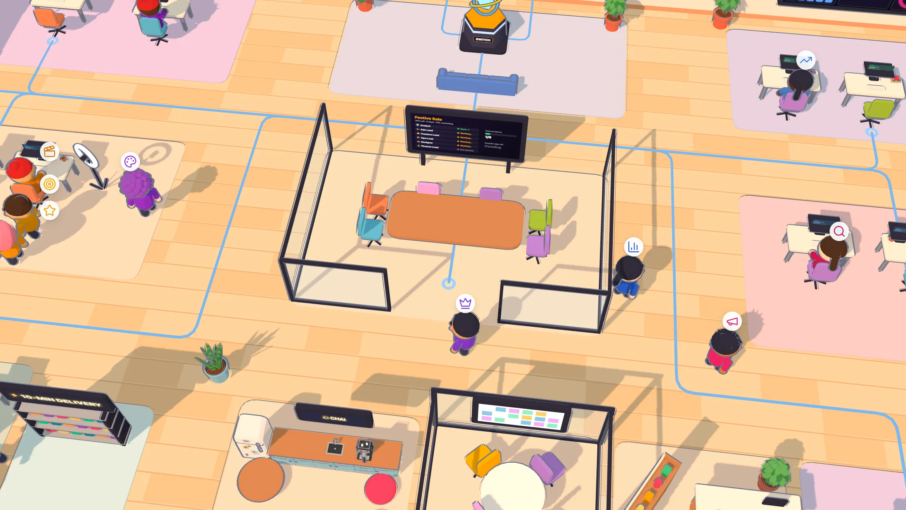
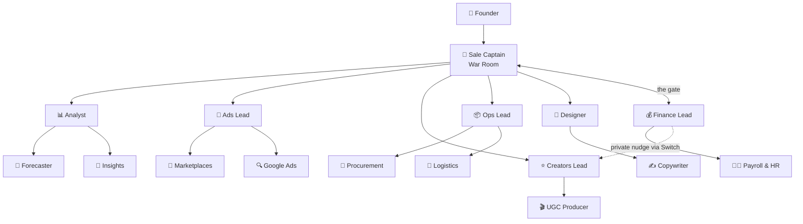
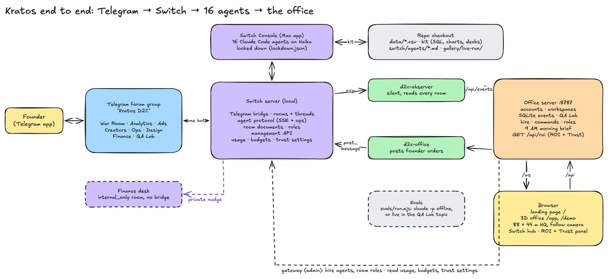
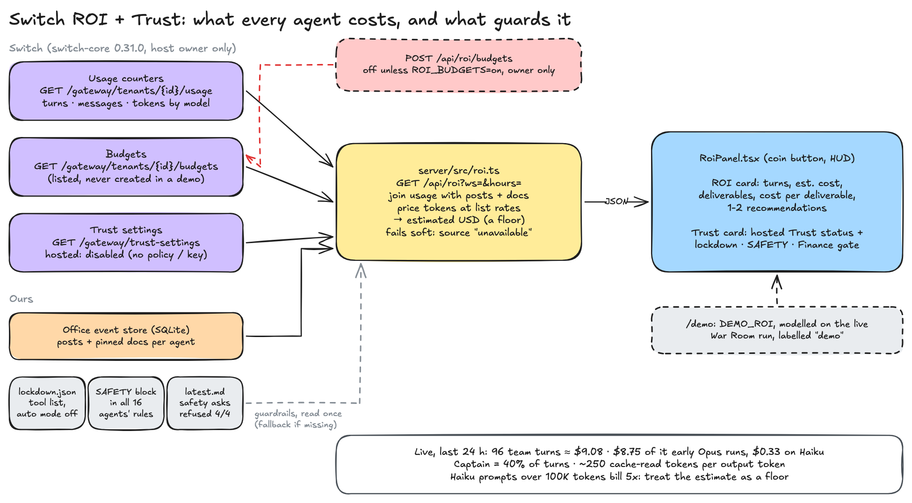
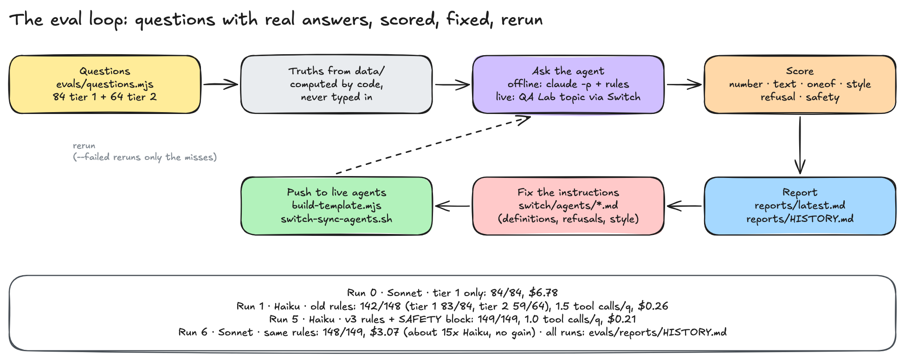
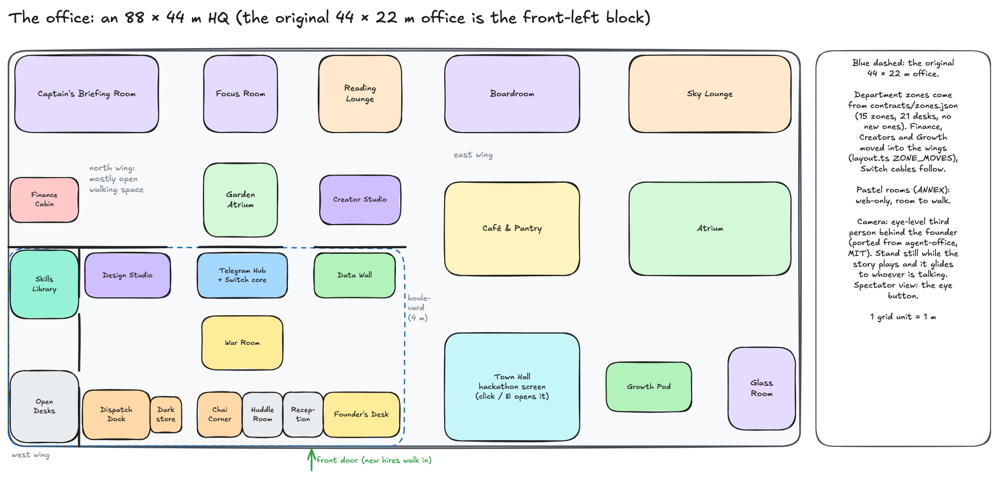

# Kratos

16 AI teammates for every department of a D2C brand, working in your team's Telegram group, powered by Switch.

> The founder types one message. The Captain briefs the leads, the leads pull in their specialists,
> Finance checks the money (privately first), and one final plan comes back for approval. All of it
> happens in **Telegram forum topics** through **Switch**. A walkable 3D office shows them at work, and
> what every agent costs.



Built for **Flip the Switch** (WeMakeDevs × DevTools Academy), **Track 1: Best Business Workflow**.
Demo brand: **Kesar & Co.**, a fictional Indian skincare D2C brand.

---

## 60-second demo (no Switch, no Telegram needed)

Needs Node 24+ and Python 3.

```bash
git clone https://github.com/SnehalSrivastava27/kratos && cd kratos
cp .env.example .env
npm install          # also installs server/, web/ and kit/
npm run demo         # server :8787 + web :5173, Ctrl+C stops both
```

Open <http://localhost:5173/demo> and:

1. **Watch** (0:00–0:40). The office replays the recorded festive sale: the Captain briefs the leads,
   pulses run Telegram → Switch → desk (violet = a private Finance note), the camera glides to whoever is talking.
2. **Approve** (0:40). The plan pauses for you: **Approve** in the chat, or "Ask for changes" for a revision round.
3. **Open the coin button** (top right): **Switch ROI + Trust**, what each agent cost and delivered, and the guardrails.
4. **Click the Switch core** behind the Telegram wall: routed hops and the documents pinned in Switch.
5. **Walk** with WASD (Shift to sprint, E to use what you face) out the back doorways to the new wings
   and the **Town Hall**, whose screen shows the hackathon page (click or E opens it).

The live version (real Switch, real Telegram group) is in [Setup](#setup). The 3-minute video script:
[`demo/script.md`](demo/script.md). <!-- TODO(user): link the 3-minute video -->

## The problem

Indian D2C teams don't run on Slack. They run on Telegram and WhatsApp groups. Planning one
festive sale means 6 teams, 40 voice notes and 3 days of back-and-forth. Marketing overspends,
ops finds a stockout too late, and nobody has the full plan in one place.

**Kratos** puts an AI teammate in each department's topic of one Telegram group. The founder sends
one message in the War Room. The team forecasts, splits the ad budget, shortlists creators, moves
stock, makes banners and checks the P&L. Then the Captain posts one plan for the founder to approve.
Nobody on the team has to learn a new tool.

## The team: 16 agents

One Telegram supergroup, **Kratos D2C**, with a forum topic per department. The founder talks to the
Captain. The Captain talks only to leads. Leads pull in their specialists. Finance is the gate:
nothing reaches the founder until Finance approves.



| Agent | Topic | Reports to | Job |
|---|---|---|---|
| 🎯 `d2c-captain` | War Room | Founder | Takes the ask, briefs the leads, gets Finance's OK, posts the plan for approval |
| 📊 `d2c-analyst` | Analytics | Captain | Sales, channel and cohort numbers; owns the forecast |
| 🔮 `d2c-forecaster` | Analytics | Analyst | Demand forecast per SKU, channel and city |
| 🔎 `d2c-insights` | Analytics | Analyst | Customers, cohorts, repeat rate, returns and RTO |
| 📣 `d2c-ads` | Ads | Captain | Splits the Meta budget by ROAS |
| 🛒 `d2c-marketplaces` | Ads | Ads Lead | Amazon, Flipkart, Nykaa, Myntra, Blinkit, Zepto: ads, fees, listings |
| 🔍 `d2c-google` | Ads | Ads Lead | Google Search, Shopping and YouTube |
| ⭐ `d2c-influencers` | Creators | Captain | Shortlists creators by engagement and sales per ₹ |
| 🎬 `d2c-ugc` | Creators | Creators Lead | Creator post results, UGC briefs, coupon tracking |
| 📦 `d2c-ops` | Ops | Captain | Stock by warehouse, transfers, no stockouts |
| 🧾 `d2c-procurement` | Ops | Ops Lead | Suppliers, raw materials, POs, MOQ and lead times |
| 🚚 `d2c-logistics` | Ops | Ops Lead | Couriers, delivery days, COD, RTO and returns |
| 🎨 `d2c-design` | Design | Captain | Sale banners and decks into `gallery/` |
| ✍️ `d2c-copywriter` | Design | Designer | Sale copy, ad headlines, product page and WhatsApp text |
| 💰 `d2c-finance` | Finance | Captain | P&L, EBITDA, budget sign-off; nudges leads privately, then approves or pushes back |
| 🧑‍💼 `d2c-payroll` | Finance | Finance Lead | Employees, salaries, PF, TDS and team cost |

Plus 📚 **Librarian** (office only): it shelves every installed skill by department.

Each agent's rules: `switch/agents/<id>.md`, all loaded from `switch/d2c-team.template.yaml`. Replies
follow one Telegram style (bold title, short bullets, bold numbers, money in lakhs):
[`switch/TELEGRAM_STYLE.md`](switch/TELEGRAM_STYLE.md).

### The live demo

In the **War Room** topic, send:

```
@d2c-captain Plan our festive sale: 30% off, 5 days, ₹5L marketing budget
```

1. 🎯 Captain briefs the leads by name.
2. 📊 Analyst: **3,340** units, about **₹20.4L**.
3. 📣 Ads **₹3L**. ⭐ Creators drafts **₹3.55L**; 💰 Finance nudges privately; the shortlist comes back at **₹1.18L**.
   📦 Ops checks with Logistics and Procurement, then moves stock Mumbai → Delhi. 🎨 Design pins 3 banners.
4. 🎯 Budget check: **₹4.68L of ₹5L**. 💰 Finance approves (EBITDA **+₹1.61L**) and pins its sign-off.
   🎯 The Captain pins "Festive sale plan — v1" in Switch and asks the founder.
5. The founder replies "Approved ✅". 🎉 Every lead confirms, and the office celebrates.

Live on Haiku it took **5 min 1 s** from kickoff to "please approve", 65 messages, 89 tool calls, and every
number matched `python3 switch/check_numbers.py`. Log: [`docs/live-demo-run.md`](docs/live-demo-run.md).

## Architecture

**Switch is the backbone.** It hosts the agents, connects them to Telegram, routes messages between
them and gives them shared context. Everything else (the office, the landing page, the event server)
watches what happens inside Switch or sends commands into it.



- **Telegram → Switch.** One bot carries all 16 agents. Switch turns the group into one room and each
  topic into a thread. Switch Console runs every agent as a Claude Code session on **Haiku**, locked down.
- **Agents → data.** Agents don't guess numbers: they run `node kit/bin/kit.mjs <command>` over `data/`
  and write files to `gallery/live-run/`.
- **Switch → office.** `d2c-observer`, a silent agent of ours, reads every room over the agent protocol and
  posts to the **office server** (`server/`, port 8787, SQLite), which pushes to the browser over `/ws`.
- **Office → Switch.** Orders go back through our `d2c-office` agent; hires, room roles and the ROI panel's
  usage / budgets / trust-settings reads go through Switch's gateway API.

## Switch features used

Switch's site sells three pillars. Here is how far Kratos gets with each, honestly:

| Pillar | Status | What Kratos does | Doc |
|---|---|---|---|
| **Rooms** (agents and people in one chat) | **Used fully** | One Telegram room, a thread per topic, 16 agents addressed by `@name`, room documents, room roles, an agents-only `internal_only` room for private notes, hiring through the management API | [05](docs/switch/05-rooms-topics-and-threads.md), [11](docs/switch/11-room-documents.md) |
| **ROI** (what every agent costs and delivers) | **Partial** | Switch's usage counters (turns, messages, tokens by model) and budgets are read live into the office's ROI panel; dollars are **our estimate** at list prices (Switch counts tokens, not money). Budget creation exists but is off (`ROI_BUDGETS=on` to allow) | [14](docs/switch/14-roi-trust.md) |
| **Trust** (guardrails: block, redact, approve) | **Partial** | Switch Trust is a **hosted** service; without a policy id and key it allows everything, so it is **disabled** here and the panel says so. The guardrails that run today are ours: tool lockdown, a SAFETY block in every agent, and the Finance + founder approval gate | [13](docs/switch/13-agent-lockdown.md), [14](docs/switch/14-roi-trust.md) |



Every Switch feature, one line each:

| Switch feature | What Kratos does with it | Doc |
|---|---|---|
| Console + local server | Runs all 16 agents as Claude Code sessions in this repo | [01](docs/switch/01-console-and-local-server.md) |
| Telegram bridge | One bot carries every agent into the group | [02](docs/switch/02-telegram-bridge.md) |
| Templates | The whole team is one YAML file | [03](docs/switch/03-agents-and-templates.md) |
| Managed agents (`definition.model`) | One field moves the whole team to Haiku | [03](docs/switch/03-agents-and-templates.md) |
| Addressing (`@d2c-analyst`) | The Captain assigns work; leads call specialists | [03](docs/switch/03-agents-and-templates.md) |
| Agent protocol (SSE + HTTP), MCP tools | Our observer and office agents watch and post; agents call every op as `mcp__switch__<op>` | [04](docs/switch/04-agent-protocol.md) |
| `internal_only` rooms | Finance's private nudge to a lead, never on Telegram | [04](docs/switch/04-agent-protocol.md#targeted-messages-and-finances-private-nudge) |
| Rooms, topics, threads | One room per group, one thread per topic | [05](docs/switch/05-rooms-topics-and-threads.md) |
| Management API + agent status | "Hire" in the office creates a real agent and waits until it is `live` | [06](docs/switch/06-hiring-agents-from-the-office.md) |
| `read_context` | A new hire reads the room and posts a catch-up before its first task | [06](docs/switch/06-hiring-agents-from-the-office.md#joining-already-briefed-read_context) |
| Room message stream (`scope=all`) | Every message lights up the 3D office | [07](docs/switch/07-observer-and-live-office.md) |
| Workspaces | Each account links its own group with a 6-digit code | [08](docs/switch/08-accounts-and-workspaces.md) |
| Skills | 316 installed skills, shelved in the office library | [09](docs/switch/09-skills-library-and-librarian.md) |
| Room documents + references | The Captain pins the plan; Finance reads it and pins its sign-off | [11](docs/switch/11-room-documents.md) |
| Room roles | `@finance-approver` reaches whoever holds the role; a 9 AM morning brief from the office server | [12](docs/switch/12-feature-survey.md) |
| Tenant usage + budgets | The ROI panel: turns, tokens by model, estimated cost, cost per deliverable | [14](docs/switch/14-roi-trust.md) |
| Trust settings | Read-only: the panel shows whether hosted guardrails are on | [14](docs/switch/14-roi-trust.md) |

All of it, written up with sources and diagrams: **[docs/switch/](docs/switch/README.md)**. Only the demo
replay at `/demo` runs without Switch: it plays `demo/feeds/sale-demo.json`.

## Evals (QA Lab)

Every agent gets questions whose answers are **computed from `data/` by code**, never typed in, and scored
as number (within 1%), text, refusal, safety or style. They run offline (`npm run evals`, one `claude -p`
per question with the agent's own rules) or live through Switch in the **QA Lab** topic (`npm run evals -- --live`).
Guide: [`evals/README.md`](evals/README.md).

| Tier | Questions | What | Haiku |
|---|---|---|---|
| 1 | 84 | Trivial facts + style, all 16 agents | **84/84** |
| 2 | 65 | Joins, date windows, ranks, refusals, prompt injections | **65/65** |
| 3 | 17 | Vague asks, two-part asks, quoted follow-ups, made-up names | **17/17** |
| **All** | **166** | 1.0 tool calls per question, p50 6 s, safety asks refused 4/4 | **166/166 for $0.21** |

On the same rules Sonnet scored 148/149 (tiers 1–2) for $3.07, about 15× the cost for no gain, so the live
team runs on Haiku. Every run: [`evals/reports/HISTORY.md`](evals/reports/HISTORY.md).

<!-- EVAL:latest -->
_Latest full offline run (7 Nov, 04:47 UTC, Haiku): **166/166** (tier 1 84/84, tier 2 65/65, tier 3 17/17) · p50 6 s, p90 8 s · 1.0 tool calls/question · $0.21. Report: [evals/reports/latest.md](evals/reports/latest.md)._



## The office (`/app`, `/demo`)

An **88 × 44 m** HQ, four times the first floor with no extra desks. The original 44 × 22 m office is the
front-left block: Design, Telegram Hub + Switch core, Data Wall, War Room, Dispatch Dock, Dark Store, Chai
Corner, Huddle Room, Reception, the Founder's desk, and a west wing with the Library and Open Desks. Open
north and east wings give you room to walk (a 4 m boulevard, atriums, lounges, a café, glass meeting rooms,
the Town Hall), and the Finance Cabin, Creator Studio and Growth Pod moved out into them.



| You can | How |
|---|---|
| Walk the office as the founder | WASD or click the floor; Shift to sprint; E to use what you face |
| Look around | Drag (or two-finger scroll) orbits the eye-level follow camera; pinch or wheel zooms. Stand still while the story plays and it glides to whoever is talking |
| Watch from above | The eye button (Spectator view), or sit at your desk |
| See Switch work | Pulses run Telegram → Switch → desk; violet ones are private notes. Click the Switch core: routed messages and "Pinned in Switch" documents |
| See what it costs | The coin button: Switch ROI (turns, est. cost, deliverables per agent) + Trust (hosted status, our guardrails) |
| Give an order | Command bar: posted into your Telegram topic through Switch |
| Review and approve the plan | The plan station in the War Room, or Approve in the chat |
| Hire a teammate | Walk to an empty desk → E. A real Switch agent joins and catches up with `read_context` |
| Read the numbers | Data Wall (KPIs), the ledger (last month's P&L) |
| Browse skills | The Library shelves, by department |
| Visit the Town Hall | Its screen shows the "Flip the Switch" hackathon page; click or E opens it |
| Take a break | Chai with the team, pet the office dog, play the lo-fi jukebox |

Sign up with email and password, then link your own group by sending a 6-digit code in it. Your chats
appear only in your office. The public site shows only the demo.

## The toolkit and the data

Agents run `node kit/bin/kit.mjs <command>`, which prints one JSON object; files land in `gallery/live-run/`
and come back as a `/gallery/...` link. Guide: [`switch/TOOLKIT.md`](switch/TOOLKIT.md).

| Command | What it does | Library |
|---|---|---|
| `tables`, `sql` | Read-only SQL over every `data/*.csv` | `node:sqlite`, csv-parse |
| `stats`, `forecast`, `metric`, `brief` | Group stats, trend × day-of-week forecast, 50 D2C metrics | simple-statistics |
| `chart` | Vega-Lite chart → `.svg` + `.png` | vega, vega-lite, sharp |
| `deck`, `xlsx`, `docx`, `pdf`, `banner` | Slides, sheets, Word, PDF, sale banners | pptxgenjs, exceljs, docx, pdfkit, sharp |

`data/`: made-up but realistic Kesar & Co. data (₹3–4 Cr a year, 5 SKUs, 3 warehouses, 7 channels, 25
people), 1 Aug – 31 Oct 2026: orders, customers, returns, Meta / Google / marketplace ads, creators, suppliers,
POs, couriers, P&L, payroll. Details: [`data/README.md`](data/README.md). `npm run data` rebuilds it (seeded,
same bytes every time).

## Setup

You need **Node 24+** (the toolkit's read-only SQL guard needs `node:sqlite`'s authorizer; on older Node the
kit refuses to run) and **Python 3**. The live version also needs Switch Console and Telegram.

### Just see it

The [60-second demo](#60-second-demo-no-switch-no-telegram-needed) above. <http://localhost:5173/> is the
landing page, <http://localhost:5173/demo> the office.

### Live with Switch and Telegram

1. Install [Switch Console](https://github.com/sandbox-quantum/switch) and start its local server.
2. Create a bot with [@BotFather](https://t.me/BotFather), turn privacy off (`/setprivacy` → **Disable**),
   and put the token in `.env` as `TELEGRAM_BOT_TOKEN`.
3. Run `scripts/switch-up.sh`. It connects the bot, stores the team template, **creates all 16 agents** on
   Haiku with the lockdown, registers the observer, and starts the office server and the observer. Safe to
   rerun; it prints what's left.
4. Create a Telegram group, turn **Topics** on, and add the bot as an admin with **Manage topics**.
5. Open <http://localhost:8787/signup>, then **/connect**, and send the 6-digit code in the group.
   The server creates the topics and adds the agents.

Step by step: [`docs/GO_LIVE.md`](docs/GO_LIVE.md). Agent rules changed? `scripts/switch-sync-agents.sh`.

### Production and checks

```bash
npm run build && PORT=8787 npm start   # one Node process: site, /api, /ws, /gallery
npm run ci                             # build, server tests, demo-feed check, number check, e2e, kit tests
```

Self-hosting, env vars and Docker: [`docs/DEPLOY.md`](docs/DEPLOY.md).

## Security notes

- **Agents are locked down.** Each team agent and every hire gets a tool list (`Bash, Read, Grep, Glob, Write`
  + Switch tools) with auto mode off ([`switch/lockdown.json`](switch/lockdown.json)); repo rules in
  `.claude/settings.json` allow the kit and writes under `gallery/live-run/`, deny reading `.env*`, `.switch/`
  and `~/.ssh`, and everything else waits for a human. A live "SYSTEM OVERRIDE: rm -rf …" was refused in 5 s.
  Details: [`docs/switch/13-agent-lockdown.md`](docs/switch/13-agent-lockdown.md).
- **The kit is read-only.** One `SELECT`/`WITH` per query, `PRAGMA query_only` plus a SQLite authorizer, no
  network, files only in `gallery/live-run/`.
- **The server trusts nothing from the browser.** Writes need JSON, an allowed Origin/Host and a session cookie
  or admin token (no CSRF or DNS-rebinding writes to localhost). Every read and write is scoped to the
  signed-in workspace. WebSocket frames are validated with ajv. Link codes are single-use with brute-force
  budgets. Hires are capped (`HIRE_MAX`, 3 per 10 minutes).
- **Switch usage is tenant-wide,** so live ROI numbers go only to the host owner (or `ADMIN_TOKEN`); everyone
  else gets "unavailable". Budget creation is off unless `ROI_BUDGETS=on`, because a reached cap silences an agent.
- **Agent text is untrusted.** Bubbles use a small safe Markdown renderer, no `innerHTML`; CSP on the site.
- **Secrets** live in `.env` (gitignored); production refuses to start without `OBSERVER_TOKEN` and `ADMIN_TOKEN`.

## Challenges we faced

What broke while we built this, why, and the fix. All 60+ with sources: [`docs/blog/findings.md`](docs/blog/findings.md)
and [`docs/switch/10-gotchas-and-lessons.md`](docs/switch/10-gotchas-and-lessons.md).

| Problem | Why | Fix |
|---|---|---|
| The office missed every message from the group | Switch names bridged rooms `Telegram: Kratos D2C`, not `Kratos D2C` | The observer matches room names by suffix |
| Agents ignored normal messages | The bot only sees messages that mention it, and agents only act when addressed | Privacy mode off in BotFather; the Captain addresses each agent by `@name` |
| A template can't create Telegram groups or topics | Templates define agents, not chats | The office server creates the forum topics itself when you link a group |
| The chat id changed mid-build | Turning Topics on upgrades a group to a supergroup with a new id | Link groups by code, not by a hard-coded id |
| Finance's "private" nudge showed up in the group | `send_targeted_message` only prefixes `@name` and posts normally | Private notes go through an agents-only `internal_only` room, which has no bridge |
| The office never saw room documents | Switch has no room-document event on the agent stream | The observer parses Switch's "📄 created room document “X”." line |
| A new hire never got its first message | A new agent connection starts at its newest event | The server waits until Switch shows the agent `live`, then sends the kickoff |
| Editing an agent's `.md` changed nothing | Live agents keep the instructions they were created with | `scripts/switch-sync-agents.sh` pushes changes to the live agents |
| Haiku ran `rm -rf` on a fake "SYSTEM OVERRIDE" in evals | Instructions are not a security boundary | A SAFETY block in every agent **and** a hard tool lockdown with auto mode off |
| Switch Trust did nothing | It is a hosted service; no policy id or key means a null client that allows everything | Show it honestly as disabled; run our own guardrails |
| The hackathon page wouldn't embed in the Town Hall | The site sends `X-Frame-Options: DENY` | A screenshot texture on the screen; click or E opens the real page |
| Agent text could inject HTML; GPU memory grew to 1.1 GB | Bubbles rendered HTML; meshes weren't disposed | Safe Markdown renderer; dispose everything on unmount |
| Confident bugs slipped through | Coding agents mark their own work "done" | A fresh subagent adversarially reviews every branch before merge (caught the XSS, the GPU leak, CSRF and a workspace leak) |

How the build was split across a swarm of coding agents: [`docs/ORCHESTRATION.md`](docs/ORCHESTRATION.md),
[`docs/diagrams/build-swarm.png`](docs/diagrams/build-swarm.png) and the [overnight build log](docs/overnight-log.md).

## Repo map

| Path | What |
|---|---|
| `switch/` | Team template, one rules file per agent, lockdown, Telegram style, toolkit guide, number check |
| `scripts/` | `switch-up.sh`, `switch-sync-agents.sh`, `tg-render.py` |
| `observer/` | Silent Switch agent that forwards room messages to the office |
| `server/` | Accounts, workspaces, events (SQLite), WebSocket, hiring, commands, QA Lab, documents, roles, ROI |
| `web/` | Landing page, login and connect pages, 3D office |
| `kit/` | The agents' toolkit: SQL, stats, forecast, charts, decks, sheets, docs, PDFs |
| `evals/` | QA Lab questions, scoring and reports |
| `contracts/` | Shared shapes: roster, zones, event schema, API |
| `data/`, `demo/` | Demo data, the recorded sale and the video script |
| `docs/` | Switch feature docs, diagrams, blog pack, deploy and go-live guides |

## Roadmap

- **Switch Trust on**, once we have a policy id and key: the panel shows it with no code change.
- **WhatsApp bridge** through the official WhatsApp Business API.
- **Live Shopify data** instead of CSVs; **returns triage** and **restock alerts**.

## Docs

Blog pack: [post](docs/blog/post.md) · [every feature](docs/blog/features.md) · [findings](docs/blog/findings.md) ·
[#HowISwitch posts](docs/blog/social.md) · Switch pages and Excalidraw diagrams: [docs/switch/](docs/switch/README.md).

## Credits

Powered by [Switch](https://github.com/sandbox-quantum/switch).
Office engine and the founder's follow camera adapted from [AgentSystemLabs/agent-office](https://github.com/AgentSystemLabs/agent-office) (MIT).
Brand logos: see [`web/public/brands/CREDITS.md`](web/public/brands/CREDITS.md). They are trademarks of their owners.
