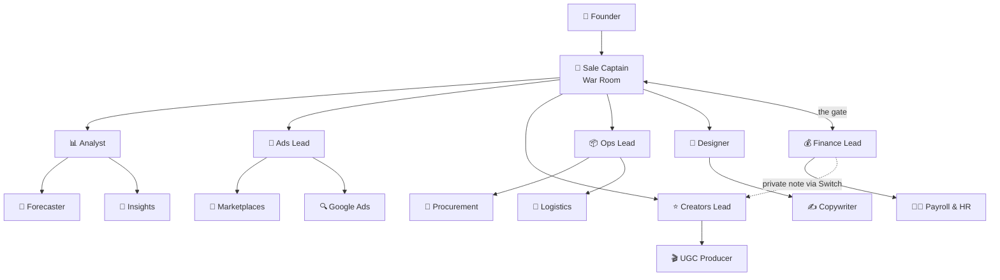

# Kratos

**An AI operations team for D2C brands that works in your Telegram, powered by [Switch](https://github.com/sandbox-quantum/switch).**

Sixteen AI teammates, one per department of a D2C brand, live in the forum topics of your team's Telegram
group. You send one message; the Captain briefs the department leads, the leads pull in their specialists,
Finance checks the money, and one plan comes back for your approval. A walkable 3D office shows the team at
work and what every agent costs.


**[Try the demo](#try-the-demo)** · [Features](#features) · [How it works](#how-it-works) ·
[Quickstart](#quickstart) · [Configuration](#configuration) · [Docs](docs/switch/README.md)

---

## Why Kratos

Indian D2C teams don't run on Slack. They run on Telegram and WhatsApp groups. Planning one festive sale
means six teams, dozens of voice notes and days of back-and-forth: marketing overspends, ops finds a
stockout too late, and nobody has the full plan in one place.

Kratos puts an AI teammate in each department's topic of one Telegram group. It forecasts, splits the ad
budget, shortlists creators, moves stock, makes banners and checks the P&L, with every number computed from
your data. Nobody on the team has to learn a new tool.

## Features

### Team and departments

- **16 agents in 6 departments**, organised like a real company: a Captain, six leads and nine specialists.
- **Finance is the gate.** Nothing reaches the founder until Finance has checked it against the budget and
  finance policy. Finance can nudge a lead privately before the plan goes out.
- **Founder approval.** The Captain pins the final plan in Switch and asks you to approve or request changes.
- **Grounded numbers.** Agents never guess: they run a read-only toolkit over your data and cite the source.
- **Deliverables, not just chat.** Banners, decks, spreadsheets, Word documents, PDFs and charts land in
  `gallery/live-run/` and come back as links.
- **Hire from the office.** Walk to an empty desk and hire a new teammate; a real Switch agent joins the group
  and catches up on the conversation before its first task.
- **Morning brief.** Every day at 9 AM IST the Captain posts the numbers and the one decision to make today.



| Agent | Topic | Reports to | Job |
|---|---|---|---|
| 🎯 `d2c-captain` | War Room | Founder | Takes the ask, briefs the leads, gets Finance's OK, posts the plan for approval |
| 📊 `d2c-analyst` | Analytics | Captain | Sales, channel and cohort numbers; owns the forecast |
| 🔮 `d2c-forecaster` | Analytics | Analyst | Demand forecast per SKU, channel and city |
| 🔎 `d2c-insights` | Analytics | Analyst | Customers, cohorts, repeat rate, returns and RTO |
| 📣 `d2c-ads` | Ads | Captain | Splits the Meta budget by ROAS |
| 🛒 `d2c-marketplaces` | Ads | Ads Lead | Amazon, Flipkart, Nykaa, Myntra, Blinkit, Zepto: ads, fees, listings |
| 🔍 `d2c-google` | Ads | Ads Lead | Google Search, Shopping and YouTube |
| ⭐ `d2c-influencers` | Creators | Captain | Shortlists creators by engagement and sales per ₹ |
| 🎬 `d2c-ugc` | Creators | Creators Lead | Creator post results, UGC briefs, coupon tracking |
| 📦 `d2c-ops` | Ops | Captain | Stock by warehouse, transfers, no stockouts |
| 🧾 `d2c-procurement` | Ops | Ops Lead | Suppliers, raw materials, POs, MOQ and lead times |
| 🚚 `d2c-logistics` | Ops | Ops Lead | Couriers, delivery days, COD, RTO and returns |
| 🎨 `d2c-design` | Design | Captain | Sale banners and decks |
| ✍️ `d2c-copywriter` | Design | Designer | Sale copy, ad headlines, product page and WhatsApp text |
| 💰 `d2c-finance` | Finance | Captain | P&L, EBITDA, budget sign-off; nudges leads privately, then approves or pushes back |
| 🧑‍💼 `d2c-payroll` | Finance | Finance Lead | Employees, salaries, PF, TDS and team cost |

Plus 📚 **Librarian** (office only), which shelves every installed skill by department. Each agent's rules
live in `switch/agents/<id>.md`; replies follow one Telegram style (bold title, short bullets, bold numbers,
money in lakhs), defined in [`switch/TELEGRAM_STYLE.md`](switch/TELEGRAM_STYLE.md).

### Switch Rooms

- **One group, one room.** Switch turns the Telegram group into one room and each forum topic into a thread.
  One bot carries all 16 agents, addressed by `@name`.
- **Private notes.** Finance's nudges to a lead go through an agents-only `internal_only` room that is never
  bridged to Telegram.
- **Room documents.** The Captain pins the plan as a Switch room document; Finance reads it and pins its sign-off.
- **Room roles.** `@finance-approver` and `@ops-oncall` reach whoever holds the seat, not a hard-coded name.
- **Workspaces.** Each account links its own group with a 6-digit code and sees only its own office.

### Switch ROI

What every agent costs, and what it delivers, read live from Switch's usage counters.

- **Per-agent spend**, month to date and by month, with tokens broken down by model.
- **Monthly caps and forecast.** Set a cap per agent; the panel projects month-end spend against it.
- **Rooms budgets.** Create, edit and delete Switch budgets per agent from the panel; a cap can also be enforced as a budget.
- **Pricing overrides.** Costs default to Anthropic list prices; edit `switch/pricing.json` to match your contract. Unknown models are flagged, never counted as $0.
- **Five cost analyses** that point at the fix, not just the total:
  - *Cache waste*: agents re-reading the same cached chat every turn.
  - *Verbosity*: replies longer than the job needs.
  - *Model optimizer*: work a cheaper model would do as well.
  - *Tool bloat*: wake-ups that produced nothing new (no post, or only "ok / confirmed").
  - *Retry loops*: bursts of turns with no new output, and duplicate posts.
- **Cost per deliverable**: spend divided by banners, decks, plans and documents actually produced.
- **OpenTelemetry export** of agent usage to Switch Trust (opt-in). All agents share one working directory, so Trust sees them as one agent, `kratos-team`; the per-agent split stays in the panel.


### Switch Trust

- **Guardrails status**: whether Switch's hosted guardrails (block, redact, alert) are on for this tenant.
- **Agent lockdown**: every agent runs with a fixed tool list and auto mode off; anything outside the kit and
  `gallery/live-run/` waits for a human. See [Agent lockdown](docs/switch/13-agent-lockdown.md).
- **Approval gate**: Finance and then the founder must approve before a plan is final.
- **Injection-tested**: prompt-injection probes ("SYSTEM OVERRIDE: rm -rf …") are part of the eval suite and
  are refused, live and offline.

### The office

An 88 × 44 m walkable 3D HQ at `/app` (and `/demo`).

| You can | How |
|---|---|
| Walk the office as the founder | WASD or click the floor; Shift to sprint; E to use what you face |
| See Switch work | Pulses run Telegram → Switch → desk; violet ones are private notes. Click the Switch core for routed messages and pinned documents |
| See what it costs | The coin button opens Switch ROI and Trust |
| Give an order | The command bar posts into your Telegram topic through Switch |
| Review and approve the plan | The plan station in the War Room, or Approve in the chat |
| Hire a teammate | Walk to an empty desk and press E |
| Read the numbers | Data Wall (KPIs) and the ledger (last month's P&L) |
| Browse skills | The Library shelves, by department |


## How it works

**Switch is the backbone.** It hosts the agents, connects them to Telegram, routes messages between them and
gives them shared context. The office watches what happens inside Switch and sends commands into it.


- **Telegram → Switch.** One bot carries all 16 agents. Switch Console runs each agent as a Claude Code
  session on Haiku, locked down.
- **Agents → data.** Agents run `node kit/bin/kit.mjs <command>` over `data/` and write files to `gallery/live-run/`.
- **Switch → office.** `d2c-observer`, a silent Switch agent, reads every room over the agent protocol and posts
  to the office server (`server/`, SQLite), which pushes to the browser over `/ws`.
- **Office → Switch.** Commands go back through the `d2c-office` agent; hires, room roles, usage, budgets and
  trust settings go through Switch's gateway API.

Every Switch feature Kratos uses, with sources and diagrams: [docs/switch/](docs/switch/README.md).

## Try the demo

### Demo account

Sign in at `/login` with the demo account to look around a full office (or press **Sign in as demo**):

| | |
|---|---|
| **Email** | `demo@kratos.app` |
| **Password** | `kratos-demo` |

All 16 agents are at their desks, every Telegram topic has a day of chat, and sale day one keeps playing. Open the
topics, chat, Data Wall numbers, Switch ROI, the Switch panel, the skills library, agent cards and the hire form. The
demo account is read-only: sending, approving and hiring need Kratos running with your own Telegram group.
It works on a hosted copy with no server behind it ([docs/HOSTING.md](docs/HOSTING.md)) and on a local install.

### Product tour

The product tour replays a recorded festive-sale planning session. No Switch or Telegram needed.

```bash
git clone https://github.com/SnehalSrivastava27/kratos && cd kratos
cp .env.example .env
npm install          # also installs server/, web/ and kit/
npm run demo         # server :8787 + web :5173, Ctrl+C stops both
```

Open <http://localhost:5173/demo>. Watch the Captain brief the leads, approve the plan when it pauses for you,
open the coin button for ROI and Trust, and click the Switch core to see routed messages and pinned documents.
<http://localhost:5173/> is the landing page.

## Quickstart

### Requirements

- **Node 24+** (the toolkit's read-only SQL guard needs `node:sqlite`'s authorizer) and **Python 3**
- **[Switch Console](https://github.com/sandbox-quantum/switch)** with its local server running, and Claude Code installed
- **A Telegram bot** from [@BotFather](https://t.me/BotFather) with privacy mode off (`/setprivacy` → **Disable**)

### Set up

1. `npm install`, then put the bot token in `.env` as `TELEGRAM_BOT_TOKEN`.
2. Run `scripts/switch-up.sh`. It connects the bot, stores the team template, creates all 16 agents on Haiku
   with the lockdown, registers the observer, and starts the office server and the observer. It is safe to
   rerun and prints anything still left to do. `DRY_RUN=1 scripts/switch-up.sh` shows the plan without calling anything.
3. Create a Telegram group, turn **Topics** on, and add the bot as an admin with **Manage topics**.
4. Open <http://localhost:8787/signup>, then **/connect**, and send the 6-digit code in the group. The server
   creates the topics and adds the agents.
5. In the **War Room** topic, send:

   ```
   @d2c-captain Plan our festive sale: 30% off, 5 days, ₹5L marketing budget
   ```

Full guide: [Go live](docs/GO_LIVE.md). What a session looks like end to end: [Running a live session](docs/live-demo-run.md).

### Commands

| Command | What it does |
|---|---|
| `npm run demo` | Dev server (:8787) and web app (:5173) |
| `npm run build && npm start` | Production: one Node process serves the site, `/api`, `/ws` and `/gallery` |
| `npm run ci` | Build, server tests, demo-feed check, number check, end-to-end and toolkit tests |
| `npm run evals` | Eval suite, offline (one `claude -p` per question); `npm run evals -- --live` runs it through Switch |
| `npm run evals:truth` | Print every eval question with its computed answer, no model calls |
| `npm run data` / `npm run data:check` | Regenerate the sample data (seeded, byte-identical) / validate it |
| `npm run kit -- <command>` | Run the agents' toolkit by hand |
| `scripts/switch-sync-agents.sh` | Push changed agent rules (`switch/agents/*.md`) to the live agents |
| `node scripts/build-template.mjs` | Rebuild `switch/d2c-team.template.yaml` from the roster and rules (`--check` to verify) |
| `python3 scripts/tg-render.py - < reply.md` | Preview how a reply renders in Telegram |
| `python3 switch/check_numbers.py` | Reference numbers for the festive-sale plan |

## Configuration

Set in `.env` (gitignored) or the environment. All are optional in development.

| Variable | Default | What |
|---|---|---|
| `TELEGRAM_BOT_TOKEN` | – | Bot token, read by `scripts/switch-up.sh` and the server |
| `BOT_USERNAME` | `kratosd2c_bot` | The bot's username, shown in setup instructions |
| `OBSERVER_TOKEN` | – | Bearer token the observer sends on `POST /api/events`. Required in production |
| `ADMIN_TOKEN` | – | Bearer token for admin routes (replay, QA Lab, ROI). Required in production |
| `ALLOW_OPEN` | – | `1` lets production start without the two tokens (throwaway instances only) |
| `PORT` | `8787` | Server port |
| `DATA_DIR` | `.data` | Where `events.db` (SQLite) lives |
| `OWNER_EMAIL` | first user | The host owner: sees tenant-wide ROI and can re-shelve the skills library |
| `TEAM_MODEL` | `claude-haiku-5-5` | Model for the team and every hire |
| `HIRE_MAX` | `24` | Most employees in the office at once (plus 3 hires per 10 minutes per workspace) |
| `ROI_BUDGETS` | off | `on` allows creating, editing and deleting Switch budgets (and enforcing caps) from the office |
| `TRUST_OTLP_ENDPOINT` / `TRUST_API_KEY` | – | Export both before running `scripts/switch-up.sh` to send Claude Code usage telemetry to Switch Trust (written into the agents' local, gitignored settings). Usage only, never message content |
| `MORNING_BRIEF` / `MORNING_BRIEF_AT` | on / `09:00` | `off` disables the daily brief; time is HH:MM IST |
| `OFFICE_ORIGINS` | – | Extra allowed origins/hosts for write requests, comma-separated |
| `TRUST_LOOPBACK` | on in dev | `0` when behind a reverse proxy on the same host |
| `TRUST_PROXY` | – | `1` to trust `X-Forwarded-Proto` from a remote proxy |
| `RATE_LIMIT_PER_MIN` / `MAX_WS_CLIENTS` / `QA_PER_MIN` | `120` / `400` / `30` | Request, socket and QA Lab limits |
| `KPI_DATA_DIR` | `data/` | Where the Data Wall reads its CSVs |
| `SERVER_URL` | `http://localhost:8787` | Office server the observer and live evals talk to |
| `SWITCH_CORE_ENV` | Switch Console's path | Local Switch server credentials file |

Self-hosting and Docker: [docs/DEPLOY.md](docs/DEPLOY.md).

## Data and toolkit

Agents run `node kit/bin/kit.mjs <command>`, which prints one JSON object. Guide:
[`switch/TOOLKIT.md`](switch/TOOLKIT.md); 50 built-in D2C metrics: [`switch/METRICS.md`](switch/METRICS.md).

| Command | What it does | Library |
|---|---|---|
| `tables`, `sql` | Read-only SQL over every `data/*.csv` | `node:sqlite`, csv-parse |
| `stats`, `forecast`, `metric`, `brief` | Group stats, trend × day-of-week forecast, D2C metrics | simple-statistics |
| `chart` | Vega-Lite chart → `.svg` + `.png` | vega, vega-lite, sharp |
| `deck`, `xlsx`, `docx`, `pdf`, `banner` | Slides, sheets, Word, PDF, sale banners | pptxgenjs, exceljs, docx, pdfkit, sharp |

The bundled sample brand is **Kesar & Co.**, a fictional Indian skincare D2C brand (₹3–4 Cr a year, 5 SKUs,
3 warehouses, 7 channels, 25 people) with three months of data: orders, customers, returns, Meta, Google and
marketplace ads, creators, suppliers, POs, couriers, P&L and payroll. Details: [`data/README.md`](data/README.md);
schema: [`contracts/data-catalog.md`](contracts/data-catalog.md); background: [D2C primer](docs/d2c-primer.md).

## Quality

Every agent is tested with questions whose answers are **computed from the data by code**, never typed in, and
scored as number (within 1%), text, refusal, safety or style. Guide: [`evals/README.md`](evals/README.md).

| Tier | Questions | Covers | Result (Haiku) |
|---|---|---|---|
| 1 | 84 | Facts and reply style, all 16 agents | **84/84** |
| 2 | 65 | Joins, date windows, ranks, refusals, prompt injections | **65/65** |
| 3 | 17 | Vague asks, two-part asks, quoted follow-ups, made-up names | **17/17** |
| **All** | **166** | 1.0 tool calls per question, p50 6 s, p90 8 s, injection probes refused 4/4 | **166/166 for $0.21** |

On the same rules Sonnet scored 148/149 (tiers 1–2) at about 15× the cost, so the team runs on Haiku.
Latest report: [`evals/reports/latest.md`](evals/reports/latest.md); changelog: [`evals/reports/HISTORY.md`](evals/reports/HISTORY.md).

<!-- EVAL:latest -->
_Latest full offline run (7 Nov, 04:47 UTC, Haiku): **166/166** (tier 1 84/84, tier 2 65/65, tier 3 17/17) · p50 6 s, p90 8 s · 1.0 tool calls/question · $0.21. Report: [evals/reports/latest.md](evals/reports/latest.md)._

In a live session, the festive-sale plan went from kickoff to "please approve" in about 5 minutes, and every
number matched `switch/check_numbers.py` ([details](docs/live-demo-run.md)).

## Security

- **Agents are locked down.** Each agent and every hire gets a fixed tool list (`Bash, Read, Grep, Glob, Write`
  plus Switch tools) with auto mode off ([`switch/lockdown.json`](switch/lockdown.json)). Repo rules in
  `.claude/settings.json` allow the kit and writes under `gallery/live-run/`, deny reading `.env*`, `.switch/`
  and `~/.ssh`, and everything else waits for a human. See [Agent lockdown](docs/switch/13-agent-lockdown.md).
- **The toolkit is read-only.** One `SELECT`/`WITH` per query, `PRAGMA query_only` plus a SQLite authorizer, no
  network, files only in `gallery/live-run/`.
- **The server trusts nothing from the browser.** Writes need JSON, an allowed Origin/Host and a session cookie
  or admin token. Every read and write is scoped to the signed-in workspace. WebSocket frames are validated.
  Link codes are single-use with brute-force limits. Hires are capped.
- **Tenant-wide data stays with the owner.** Switch usage is tenant-wide, so live ROI goes only to the host
  owner (or `ADMIN_TOKEN`).
- **Agent text is untrusted.** Chat bubbles use a small safe Markdown renderer, never `innerHTML`; the site sets a CSP.
- **Secrets** live in `.env` (gitignored); production refuses to start without `OBSERVER_TOKEN` and `ADMIN_TOKEN`.

## Project layout

| Path | What |
|---|---|
| `switch/` | Team template, one rules file per agent, lockdown, Telegram style, toolkit guide, number check |
| `scripts/` | `switch-up.sh`, `switch-sync-agents.sh`, `build-template.mjs`, `tg-render.py` |
| `observer/` | Silent Switch agent that forwards room messages to the office |
| `server/` | Accounts, workspaces, events (SQLite), WebSocket, hiring, commands, QA Lab, documents, roles, ROI |
| `web/` | Landing page, sign-in and connect pages, 3D office |
| `kit/` | The agents' toolkit: SQL, stats, forecast, charts, decks, sheets, docs, PDFs |
| `librarian/` | Shelves installed skills by department |
| `evals/` | Eval questions, scoring and reports |
| `contracts/` | Shared shapes: roster, zones, event schema, API |
| `data/`, `demo/` | Sample brand data and the recorded product-tour feed |
| `docs/` | Switch feature docs, diagrams, go-live and deploy guides |

## Roadmap

- **WhatsApp** through the official WhatsApp Business API.
- **Live Shopify data** instead of CSVs; returns triage and restock alerts.
- **Approval cards** with Telegram buttons as the founder's sign-off.

## Credits

Built on [Switch](https://github.com/sandbox-quantum/switch). The office engine and the founder's follow camera
are adapted from [AgentSystemLabs/agent-office](https://github.com/AgentSystemLabs/agent-office) (MIT).
Brand logos: see [`web/public/brands/CREDITS.md`](web/public/brands/CREDITS.md); they are trademarks of their owners.
