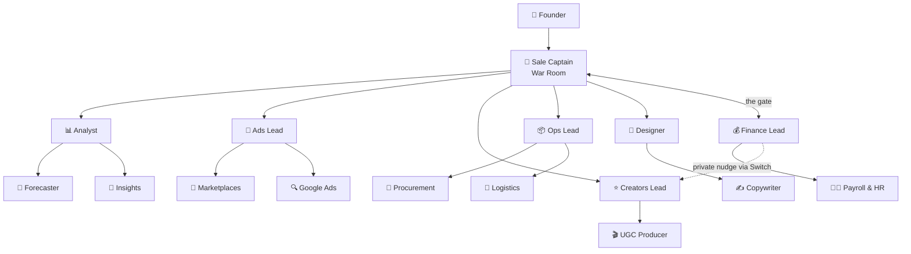

# Kratos

16 AI teammates for every department of a D2C brand, working in your team's Telegram group, powered by Switch.

> The founder types one message. The Captain briefs the leads, the leads pull in their specialists,
> Finance checks the money (privately first), and one final plan comes back for approval. All of it
> happens in **Telegram forum topics** through **Switch**. A live 3D office shows them at work.


Built for **Flip the Switch** (WeMakeDevs × DevTools Academy), **Track 1: Best Business Workflow**.
Demo brand: **Kesar & Co.**, a fictional Indian skincare D2C brand.

---

## 1. The problem

Indian D2C teams don't run on Slack. They run on Telegram and WhatsApp groups. Planning one
festive sale means 6 teams, 40 voice notes and 3 days of back-and-forth. Marketing overspends,
ops finds a stockout too late, and nobody has the full plan in one place.

**Kratos** puts an AI teammate in each department's topic of one Telegram group. The founder sends
one message in the War Room. The team forecasts, splits the ad budget, shortlists creators, moves
stock, makes banners and checks the P&L. Then the Captain posts one plan for the founder to approve.
Nobody on the team has to learn a new tool.

## 2. The team: 16 agents

One Telegram supergroup, **Kratos D2C**, with a forum topic per department. The founder talks to the
Captain. The Captain talks only to leads. Leads pull in their specialists. Finance is the gate:
nothing reaches the founder until Finance approves.



| Agent | Topic | Reports to | Job |
|---|---|---|---|
| 🎯 `d2c-captain` | War Room | Founder | Takes the ask, briefs the leads, gets Finance's OK, posts the plan for approval |
| 📊 `d2c-analyst` | Analytics | Captain | Sales, channel and cohort numbers; owns the forecast |
| 🔮 `d2c-forecaster` | Analytics | Analyst | Demand forecast per SKU, channel and city |
| 🔎 `d2c-insights` | Analytics | Analyst | Customers, cohorts, repeat rate, returns and RTO |
| 📣 `d2c-ads` | Ads | Captain | Splits the Meta budget by ROAS |
| 🛒 `d2c-marketplaces` | Ads | Ads Lead | Amazon, Flipkart, Nykaa, Myntra, Blinkit, Zepto: ads, fees, listings |
| 🔍 `d2c-google` | Ads | Ads Lead | Google Search, Shopping and YouTube |
| ⭐ `d2c-influencers` | Creators | Captain | Shortlists creators by engagement and sales per ₹ |
| 🎬 `d2c-ugc` | Creators | Creators Lead | Creator post results, UGC briefs, coupon tracking |
| 📦 `d2c-ops` | Ops | Captain | Stock by warehouse, transfers, no stockouts |
| 🧾 `d2c-procurement` | Ops | Ops Lead | Suppliers, raw materials, POs, MOQ and lead times |
| 🚚 `d2c-logistics` | Ops | Ops Lead | Couriers, delivery days, COD, RTO and returns |
| 🎨 `d2c-design` | Design | Captain | Sale banners and decks into `gallery/` |
| ✍️ `d2c-copywriter` | Design | Designer | Sale copy, ad headlines, product page and WhatsApp text |
| 💰 `d2c-finance` | Finance | Captain | P&L, EBITDA, budget sign-off; nudges leads privately, then approves or pushes back |
| 🧑‍💼 `d2c-payroll` | Finance | Finance Lead | Employees, salaries, PF, TDS and team cost |

Plus 📚 **Librarian** (office only): it shelves every installed skill by department.

Each agent's rules: `switch/agents/<id>.md`, all loaded from `switch/d2c-team.template.yaml`. Replies
follow one Telegram style (bold title, short bullets, bold numbers, money in lakhs, under ₹1 lakh in
rupees): [`switch/TELEGRAM_STYLE.md`](switch/TELEGRAM_STYLE.md).

## 3. How Switch powers it

**Switch is the backbone.** It hosts the agents, connects them to Telegram, routes messages between
them and gives them shared context. Everything else here (the office, the landing page, the event
server) watches what happens inside Switch or sends commands into it.


```
Founder's phone (Telegram, group "Kratos D2C" with forum topics)
        │
        ▼
┌──────────────────────────┐  Telegram bridge  ┌──────────────────────────────────┐
│ Switch (Console + core)  │◄─────────────────►│ War Room · Analytics · Ads ·     │
│ 16 agents · rooms ·      │                   │ Creators · Ops · Design · Finance│
│ threads · documents      │                   │ · QA Lab                         │
└──────┬─────────────▲─────┘                   └──────────────────────────────────┘
       │ agent       │ management API (hire) + agent message API (commands, QA Lab)
       │ protocol    │
       ▼             │
 d2c-observer ──POST /api/events──► Office server :8787 ──/ws──► 3D office (/app)
 (silent agent)                     (accounts, SQLite)          landing page (/)
```

### Every Switch feature we use

| Switch feature | What Kratos does with it | Doc |
|---|---|---|
| Console + local server | Runs all 16 agents as Claude Code sessions in this repo | [01](docs/switch/01-console-and-local-server.md) |
| Telegram bridge | One bot carries every agent into the group | [02](docs/switch/02-telegram-bridge.md) |
| Templates | The whole team is one YAML file | [03](docs/switch/03-agents-and-templates.md) |
| Addressing (`@d2c-analyst`) | The Captain assigns work; leads call specialists | [03](docs/switch/03-agents-and-templates.md) |
| Agent protocol (SSE + HTTP) | Our observer and office agents watch and post | [04](docs/switch/04-agent-protocol.md) |
| Targeted messages + `internal_only` rooms | Finance's private nudge to a lead, never on Telegram | [04](docs/switch/04-agent-protocol.md#targeted-messages-and-finances-private-nudge) |
| Rooms, topics, threads | One room per group, one thread per topic | [05](docs/switch/05-rooms-topics-and-threads.md) |
| Management API | "Hire" in the office creates a real agent | [06](docs/switch/06-hiring-agents-from-the-office.md) |
| `read_context` | A new hire reads the room and posts a catch-up before its first task | [06](docs/switch/06-hiring-agents-from-the-office.md#joining-already-briefed-read_context) |
| Agent status (`rooms[].status`) | The server waits until a hire is `live` before its kickoff | [06](docs/switch/06-hiring-agents-from-the-office.md) |
| Room message stream (`scope=all`) | Every message lights up the 3D office | [07](docs/switch/07-observer-and-live-office.md) |
| Workspaces | Each account links its own group with a 6-digit code | [08](docs/switch/08-accounts-and-workspaces.md) |
| Skills | 316 installed skills, shelved in the office library | [09](docs/switch/09-skills-library-and-librarian.md) |
| Room documents + references | The Captain pins the plan; Finance reads it and pins its sign-off | [11](docs/switch/11-room-documents.md) |
| MCP tools (`mcp__switch__<op>`) | Agents call every Switch operation as a tool | [04](docs/switch/04-agent-protocol.md) |

All of it, written up for a blog with sources and Excalidraw diagrams: **[docs/switch/](docs/switch/README.md)**.

Only the **demo replay** at `/demo` runs without Switch: it plays `demo/feeds/sale-demo.json` so
anyone can see the UI offline.

## 4. The toolkit (`kit`)

Agents don't guess numbers. They run `node kit/bin/kit.mjs <command>`, which prints one JSON object.
Files land in `gallery/live-run/` and come back as a `/gallery/...` link. Guide: [`switch/TOOLKIT.md`](switch/TOOLKIT.md).

| Command | What it does | Library |
|---|---|---|
| `tables`, `sql` | Read-only SQL over every `data/*.csv` | `node:sqlite`, csv-parse |
| `stats` | Count, sum, mean, median, p10, p90 (per group) | simple-statistics |
| `forecast` | Trend × day-of-week × uplift | simple-statistics |
| `chart` | Vega-Lite chart → `.svg` + `.png` | vega, vega-lite, sharp |
| `deck` | Slides (the sale plan deck) | pptxgenjs |
| `xlsx` | Spreadsheets | exceljs |
| `docx` | Word documents | docx |
| `pdf` | PDF reports | pdfkit |
| `banner` | Sale banners | sharp |

## 5. The data

All in `data/`: made-up but realistic data for Kesar & Co. (₹3–4 Cr a year, 5 SKUs, 3 warehouses,
7 channels, 25 people), from 1 Aug to 31 Oct 2026. Details: [`data/README.md`](data/README.md).

| Area | Files |
|---|---|
| Products and stock | `products`, `inventory_snapshot`, `warehouses`, `regions` |
| Sales | `orders`, `customers`, `returns`, `past_sales`, `channels`, `channel_fees` |
| Marketing | `meta_campaigns`, `meta_ads_daily`, `google_ads_daily`, `marketplace_ads_daily` |
| Creators | `influencers`, `creators`, `creator_posts` |
| Supply | `suppliers`, `raw_materials`, `bom`, `purchase_orders`, `couriers` |
| Money and people | `pnl_monthly`, `opex`, `employees`, `payroll_2026_10`, `budget.json`, `finance_policy.json` |

`npm run data` rebuilds the generated files (seeded, same bytes every time). `python3 switch/check_numbers.py`
prints the sale numbers the demo uses (forecast ₹20.4L, EBITDA +₹1.29L at ₹5L marketing).

## 6. Evals (QA Lab)

Every agent gets simple questions with answers computed from `data/`. Score: number, text or
style. They run offline (`claude -p`) or live through Switch in the **QA Lab** topic. Guide:
[`evals/README.md`](evals/README.md).

| Tier | Questions | Score |
|---|---|---|
| 1: trivial facts + style | 84 | **84/84** (all 16 agents) |
| 2: joins, date windows, ranks, refusals, prompt injections | 65 | **65/65** on Haiku (149/149 overall, $0.20 a run; Sonnet 148/149 at $3.07). History: [`evals/reports/HISTORY.md`](evals/reports/HISTORY.md) |

## 7. The office (`/app`)

A 44 × 22 m floor in three rows of pods (Design, Telegram Hub + Switch, Data Wall; Creator Studio,
War Room, Growth Pod; Dispatch Dock, Dark Store, Chai Corner, Huddle Room, Reception, Founder's
desk) and a west wing (Library, Finance Cabin, Open Desks).

| You can | How |
|---|---|
| Walk the office as the founder | WASD or click the floor; Shift to sprint; E to use what you face |
| Watch from above | The eye button (Spectator view), or sit at your desk |
| See Switch work | Pulses run Telegram → Switch → desk; violet ones are private notes. Click the Switch core or chip: routed messages and "Pinned in Switch" documents |
| Give an order | Command bar: posted into your Telegram topic through Switch |
| Review and approve the plan | The plan station in the War Room, or Approve in the chat |
| Hire a teammate | Walk to an empty desk → E. A real Switch agent joins and catches up with `read_context` |
| Talk to an agent | Walk up to it → E |
| Read the numbers | Data Wall (KPIs), the ledger (last month's P&L) |
| Browse skills | The Library shelves, by department |
| Take a break | Chai with the team, pet the office dog, play the lo-fi jukebox |

Sign up with email and password, then link your own group by sending a 6-digit code in it. Your
chats appear only in your office. The public site shows only the demo.

## 8. Setup

You need Node 24+ (the toolkit needs node:sqlite's authorizer) and Python 3. The live version also needs Switch Console and Telegram.

### 8a. Just see it (no Switch, no Telegram)

```bash
git clone https://github.com/SnehalSrivastava27/kratos && cd kratos
cp .env.example .env
npm install          # also installs server/ and web/
npm run demo         # server :8787 + web :5173, Ctrl+C stops both
```

- <http://localhost:5173/>: the landing page.
- <http://localhost:5173/demo>: the office plays the recorded sale and waits for you to approve.

### 8b. Live with Switch and Telegram

1. Install [Switch Console](https://github.com/sandbox-quantum/switch) and start its local server.
2. Create a bot with [@BotFather](https://t.me/BotFather), turn privacy off (`/setprivacy` → **Disable**),
   and put the token in `.env` as `TELEGRAM_BOT_TOKEN`.
3. Run `scripts/switch-up.sh`. It connects the bot, stores the team template, **creates all 16 agents**
   (team agents run on **Haiku** to keep Telegram replies cheap), registers the observer, and starts the
   office server and the observer. Safe to rerun; it prints what's left.
4. Create a Telegram group, turn **Topics** on, and add the bot as an admin with **Manage topics**.
5. Open <http://localhost:8787/signup>, then **/connect**, and send the 6-digit code in the group.
   The server creates the topics and adds the agents.

Step by step: [`docs/GO_LIVE.md`](docs/GO_LIVE.md). Agent rules changed? `scripts/switch-sync-agents.sh`.

### 8c. Production

```bash
npm run build && PORT=8787 npm start   # one Node process: site, /api, /ws, /gallery
npm run ci                             # build, server tests, demo-feed check, number check, e2e, kit tests
```

Self-hosting and Docker: [`docs/DEPLOY.md`](docs/DEPLOY.md).

### Run the demo

In the **War Room** topic, send:

```
@d2c-captain Plan our festive sale: 30% off, 5 days, ₹5L marketing budget
```

1. 🎯 Captain briefs the leads by name.
2. 📊 Analyst: **3,340** units, about **₹20.4L**.
3. 📣 Ads **₹3L**. ⭐ Creators drafts **₹3.55L**; 💰 Finance nudges privately; the shortlist comes back at **₹1.18L**.
   📦 Ops checks with Logistics and Procurement, then moves stock Mumbai → Delhi. 🎨 Design pins 3 banners.
4. 🎯 Budget check: **₹4.68L of ₹5L**. 💰 Finance approves (EBITDA **+₹1.61L**) and pins its sign-off.
   🎯 The Captain pins "Festive sale plan — v1" in Switch and asks the founder.
5. The founder replies "Approved ✅". 🎉 Every lead confirms, and the office celebrates.

The 3-minute video script: [`demo/script.md`](demo/script.md).

## 9. Challenges we faced

What broke while we built this, why it broke, and how we fixed it. More detail on the Switch
ones: [`docs/switch/10-gotchas-and-lessons.md`](docs/switch/10-gotchas-and-lessons.md).

### Switch and Telegram

| Problem | Why | Fix |
|---|---|---|
| The office missed every message from the group | Switch names bridged rooms `Telegram: Kratos D2C`, not `Kratos D2C` | The observer matches room names by suffix |
| Agents ignored normal messages | The bot only sees messages that mention it, and agents only act when addressed | Privacy mode off in BotFather; the Captain addresses each agent by `@name` |
| A template can't create Telegram groups or topics | Templates define agents, not chats | The office server creates the forum topics itself when you link a group |
| The chat id changed mid-build | Turning Topics on upgrades a group to a supergroup with a new id | Link groups by code, not by a hard-coded id |
| A new forum topic isn't a Switch thread yet | Switch only learns a thread after a message arrives in it | Commands fall back to General with a `#Topic` tag until the thread is known |
| Duplicate "Kratos D2C" rooms | The old basic group and the new supergroup both stayed in Switch | Match by chat id stored per workspace |
| Bot replies looked ugly in Telegram | Agents wrote Markdown tables and headings, and Telegram shows broken `**` and `_` | One strict style block in every agent's rules, plus Markdown → Telegram HTML with a 4096-char limit; `scripts/tg-render.py` previews a reply |
| Editing an agent's `.md` changed nothing | Live agents keep the instructions they were created with | `scripts/switch-sync-agents.sh` pushes changes to the live agents and checks each one |
| Hiring needed a click in Switch Console | Templates are applied from the Console UI | The office hires through Switch's management API (`POST /gateway/management/agents`) |
| Two observers posted every event twice | A restarted observer left the old one running | One observer process, started by `switch-up.sh` |
| We can't check that whoever sends a link code is a group admin | Switch passes only the sender's display name | The code is private to your account, and setup only finishes once an admin makes the bot an admin |
| Finance's "private" nudge showed up in the group | `send_targeted_message` only prefixes `@name` and posts normally, so the bridge sends it to Telegram | Private notes go through an agents-only `internal_only` Switch room (the Finance desk), which has no bridge |
| The office never saw room documents | Switch has no room-document event on the agent stream | Switch posts "📄 created room document “X”." from the agent; the observer parses that line into an artifact with `meta.switch_document` |
| A new hire never got its first message | A new agent connection starts at its newest event, so anything sent before it is live is lost | The server waits until Switch shows the agent `live` in the room, then sends the kickoff |

### The office and landing page

| Problem | Why | Fix |
|---|---|---|
| First office looked like a toy | Plain boxes and spheres | Rebuilt it on an imperative three.js engine in the style of agent-office: toon shading, path-finding, walkable player |
| 3D models didn't load in production | Our CSP blocked the WASM mesh decoder | Added `'wasm-unsafe-eval'` to `script-src` |
| GPU memory grew from 318 MB to 1.1 GB | Meshes and textures weren't disposed when people left the scene | Dispose meshes, materials and textures when the office unmounts |
| Agent text could inject HTML | Bubbles rendered agent output as HTML | A small safe Markdown renderer, with no `innerHTML` |
| The landing page went blank | Adding the Librarian to the roster gave the hero an agent without a room | Only agents with a department room are shown |
| The rotating WhatsApp / Telegram / Slack logo clipped and jumped | Fixed `em` widths, and a flex column stretched every word to the widest | Measure each word's real width and use `items-start`; `1lh` height for the baseline |
| Brand logos had uneven padding | The Flipkart SVG's viewBox was much larger than the logo | Cropped the viewBox to the logo's pixel bounds |
| Design was rejected twice | A dark theme and then a flat one didn't fit the brand | Light shadcn/ui in a Supercut-style layout, with Lucide icons and real brand logos |

### Server and security

| Problem | Why | Fix |
|---|---|---|
| "Only on this Mac" wasn't safe | Any website you open can POST to `localhost` (CSRF, DNS rebinding) | Writes need JSON, an allowed Origin/Host, and a session cookie or admin token |
| A hire leaked into another workspace | Hires weren't scoped to the account | Every write is scoped to the signed-in workspace |
| A bad WebSocket frame crashed the server | No validation on incoming frames | ajv validation, and errors are dropped per socket |
| Link codes could be guessed | 6 digits with no limit | Single-use codes, claimed atomically, with brute-force budgets |
| Unlimited hiring | Each hire creates a real agent | At most `HIRE_MAX` (24) people, and 3 hires per 10 minutes |
| The live Design agent overwrote committed banners | It wrote into the same `gallery/` folder | Live output goes to `gallery/live-run/` (gitignored) |

### Building with a swarm of agents

| Problem | Why | Fix |
|---|---|---|
| Agents edited each other's files | Many coding agents in one repo | One git worktree and branch per task, file ownership in each brief, and read-only `contracts/` |
| `claude -p` workers stalled | Headless runs can't approve shell commands | Ran the workers as subagents inside their worktrees instead |
| Removing Finance broke the build | Office state still referenced the `finance` zone | Removed the zone everywhere; CI now builds every package on each push |
| Confident bugs slipped through | Agents mark their own work "done" | A fresh subagent adversarially reviews every branch before merge. It caught the XSS, the GPU leak, CSRF and the workspace leak above |
| CI failed but local passed | A library test wiped a shared fixture, and the CI runner has no skills installed | Tests rewrite their fixtures on every start |
| Every generated deck was corrupt | pptxgenjs wrote "Kesar & Co." into the deck metadata without escaping `&` | Escape the brand name before it reaches the deck metadata |
| Evals stopped telling good instructions from great ones | At 84/84 every agent passes trivial questions | A harder tier: joins, date windows, refusals and multi-step questions |

How the build was split: [`docs/ORCHESTRATION.md`](docs/ORCHESTRATION.md) and
[`docs/diagrams/build-swarm.png`](docs/diagrams/build-swarm.png).


## 10. Repo map

| Path | What |
|---|---|
| `switch/` | Team template, one rules file per agent, Telegram style, toolkit guide, number check |
| `scripts/` | `switch-up.sh`, `switch-sync-agents.sh`, `tg-render.py` |
| `observer/` | Silent Switch agent that forwards room messages to the office |
| `server/` | Accounts, workspaces, events (SQLite), WebSocket, hiring, commands, QA Lab, documents |
| `web/` | Landing page, login and connect pages, 3D office |
| `kit/` | The agents' toolkit: SQL, stats, forecast, charts, decks, sheets, docs, PDFs |
| `evals/` | QA Lab questions, scoring and reports |
| `contracts/` | Shared shapes: roster, zones, event schema, API |
| `data/`, `demo/` | Demo data, the recorded sale and the video script |
| `docs/` | Switch feature docs, diagrams, deploy and go-live guides, [overnight build log](docs/overnight-log.md) |

## 11. Roadmap

- **WhatsApp bridge** through the official WhatsApp Business API.
- **Live Shopify data** instead of CSVs.
- **Returns triage** and **restock alerts**.

## Docs

Blog pack: [post](docs/blog/post.md) · [every feature](docs/blog/features.md) · [findings](docs/blog/findings.md) · [#HowISwitch posts](docs/blog/social.md) · Switch pages and 14 Excalidraw diagrams: [docs/switch/](docs/switch/README.md).

## Credits

Powered by [Switch](https://github.com/sandbox-quantum/switch).
Office style inspired by [AgentSystemLabs/agent-office](https://github.com/AgentSystemLabs/agent-office) (MIT).
Brand logos: see [`web/public/brands/CREDITS.md`](web/public/brands/CREDITS.md). They are trademarks of their owners.
