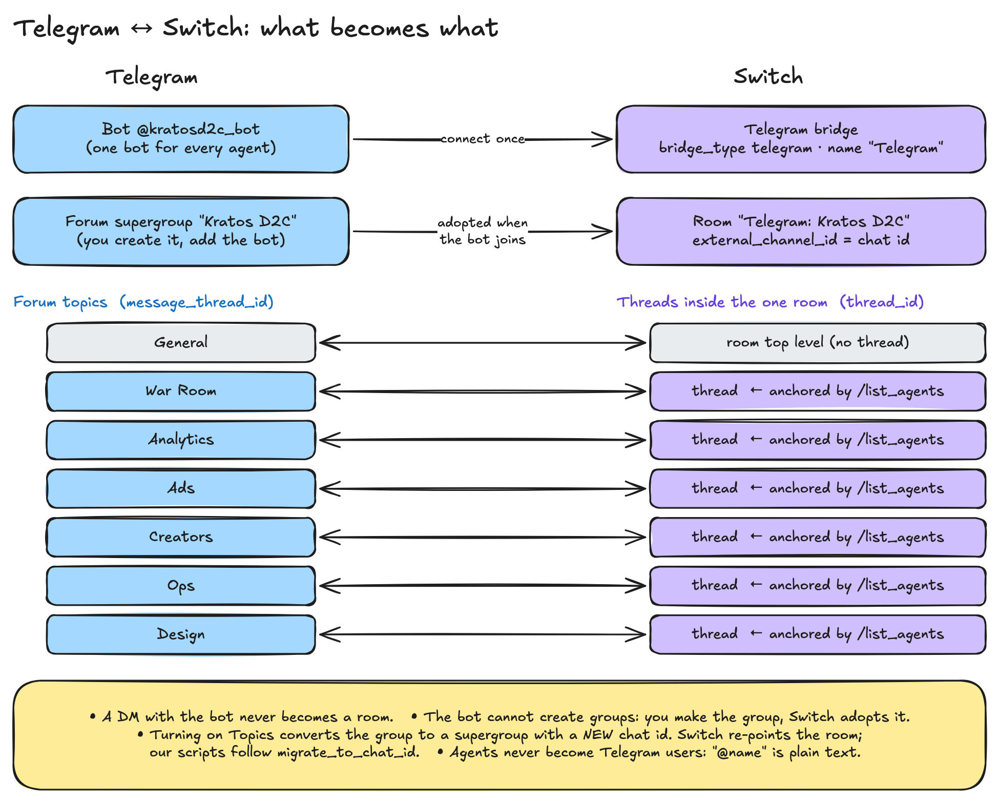

# 02 · The Telegram bridge

**One idea:** one Telegram bot speaks for every agent. Switch adds each agent's name to the top
of its message, converts its Markdown to Telegram's HTML, and splits long replies safely.



## One bot for all agents

"Single-bot identity model. Telegram has no per-message identity override … so every agent posts
through the one bot and is distinguished by its name rendered at the head of the message."
(`switch:core/switch_core/bridges/collaboration/telegram/adapter.py:505-511`)

So you make **one** bot with BotFather (`/newbot`), save the token (BotFather shows it once), and
connect it once. We named ours `@kratosd2c_bot`. Inbound messages arrive by **long polling**, an
outbound connection, so **no public URL or webhook** is needed (`adapter.py:510-511`,
`switch:docs/official/deploy/messaging-apps/telegram.md:9`).

Connecting is a click in Console (**Home → Messaging apps → Connect → Telegram**) or, in our
script, one gateway call as Console's admin:

```python
{"bridge_type": "telegram", "display_name": "Telegram",
 "connection_config": {"bot_token": "<from .env>", "bot_username": "kratosd2c_bot"},
 "set_as_default": True, "channel_creation_enabled": False}
```
`POST /gateway/collaborations` (`scripts/switch-up.sh:57-65`). The token lives only in the
gitignored `.env`. Our scripts never call `getUpdates` or `setWebhook` themselves, because Switch
is the one polling the bot (`scripts/switch-up.sh:13`).

## Privacy mode vs. admin

BotFather turns **Group Privacy on** by default. A bot in that state only receives `/commands`,
replies to itself and messages that tag it (`adapter.py:819-827`). Two ways out:

| Route | What you do | Note |
|---|---|---|
| Privacy off (global) | `/mybots` → bot → Bot Settings → Group Privacy → Turn off, **before** adding the bot anywhere | Telegram reads it when the bot joins. Groups joined earlier stay mention-only until you remove and re-add the bot |
| Admin (per chat) | Make the bot an admin of the group | "admin status alone is the exemption" (`telegram.md:212`) |

Kratos needs the bot as admin anyway (with **Manage topics**) so it can create the forum topics,
which also settles privacy for that group.

## Groups become rooms

You can't create a Telegram group from a bot. You make the group, add the bot, and Switch adopts
it as a **room** named after the group (`switch:docs/official/deploy/messaging-apps/telegram.md:13,79-83`).
A DM with the bot never becomes a room (`telegram.md:95-101`). The room's name gets the bridge's
display name as a prefix: `"Telegram: Kratos D2C"` (see [05](05-rooms-topics-and-threads.md)).

## Forum topics = threads

In a forum group every message carries a `message_thread_id`. Switch uses it as the thread root:

```python
thread_id = getattr(message, "message_thread_id", None)
if thread_id:
    return str(thread_id)
```
(`adapter.py:3147-3160`). Replies go back with `message_thread_id` set, so an agent's answer lands
in the topic it was asked in (`adapter.py:3460-3470`). Kratos uses **one group, six topics**:
War Room, Analytics, Ads, Creators, Ops, Design. Details in [05](05-rooms-topics-and-threads.md).

## How an agent appears

Agents are not Telegram users. Each post starts with a coloured mark and the agent's name in
bold:

```python
name = f"{cls._agent_marker(sender_name)} <b>{html.escape(label, quote=False)}</b>"
return f"{name}\n{content}" if "\n" in content else f"{name}: {content}"
```
(`adapter.py:3352-3380`). The mark is one of a fixed set of coloured circles, picked by a
`blake2b` hash of the agent's identifier, so it stays the same across restarts and an agent can't
fake another's colour by changing its display name (`adapter.py:3321-3349`).

Consequences you will notice:

- `@d2c-captain` does **not** autocomplete and is not a link. You type the name. Run
  `!list-agents` to see who is in the chat (`telegram.md:183-189`).
- While an agent works, your message gets a 👀 reaction and the bot posts "⚙️ Working on it…",
  edited in place and removed at the end (`telegram.md:191-199`).

## Markdown → Telegram HTML

Agents write Markdown. Telegram's own "MarkdownV2" needs a long list of characters escaped and
rejects the whole message for one stray character, so Switch converts to Telegram's small HTML
subset instead (`adapter.py:2407-2470`, `_render_outbound`):

1. Pull code blocks and inline code out first, so their contents are never treated as markup.
2. HTML-escape the rest.
3. `# heading` → `<b>`, `- bullet` → `• `, `**bold**` → `<b>`, `~~x~~` → `<s>`, `*x*` / `_x_` → `<i>`.
4. Links become `<a>` only for `http(s)://`, `tg://`, `mailto:`; anything else stays visible as code.
5. Tables are left as plain text (Telegram has none).

We mirrored that function in [`scripts/tg-render.py`](../../scripts/tg-render.py) (same regexes,
same order) so we can preview a reply without sending it:

```bash
python3 scripts/tg-render.py - < reply.md
```

### The real example

What the Ops agent writes (the example in `switch/agents/d2c-ops.md`):

```markdown
📦 **Stock plan for the sale**

- **Delhi:** short by **70** Vitamin C Serum
- **Delhi:** short by **40** Glow Kits
- **Mumbai:** has **400** spare of both

**_Move stock Mumbai → Delhi by 9 Nov, or Delhi orders take 4 days._**

_Next: @d2c-captain please approve the transfer._
```

What Switch sends to Telegram (`python3 scripts/tg-render.py`, real output):

```html
📦 <b>Stock plan for the sale</b>

• <b>Delhi:</b> short by <b>70</b> Vitamin C Serum
• <b>Delhi:</b> short by <b>40</b> Glow Kits
• <b>Mumbai:</b> has <b>400</b> spare of both

<b><i>Move stock Mumbai → Delhi by 9 Nov, or Delhi orders take 4 days.</i></b>

<i>Next: @d2c-captain please approve the transfer.</i>
```

The bridge then puts the agent's mark and **d2c-ops** in bold on the line above.

### Why our style rules forbid some Markdown

Telegram rejects HTML whose tags cross, like `<b><i>x</b></i>`. Bold numbers inside the bold-italic
line produce exactly that, and `snake_case` inside an italic line breaks the italics. Our renderer
self-check proves both (`scripts/tg-render.py:83-84`):

```python
assert not well_nested(render("**_Spend **₹5L** now_**"))  # why the rules forbid bold inside the key line
assert "_" in render("_Next: post in war_room topic_")      # snake_case breaks an italic line
```

So the shared style block says: "Inside those two lines add no extra \*\* or \_" and "Never use
tables, # headings, code blocks" (`switch/TELEGRAM_STYLE.md:11-13`). See [03](03-agents-and-templates.md).

## The 4,096-character limit

"Telegram caps a message at 4,096 characters and rejects anything longer outright."
(`switch:core/switch_core/bridges/collaboration/telegram/chunking.py:1-20`, `MAX_MESSAGE = 4096`)

Switch splits long replies itself, after rendering:

- it cuts on a line break when one is late enough, and **never inside a tag** (`safe_split`);
- tags open at the cut are **closed at the end of one piece and reopened at the start of the next**,
  so both halves stay valid HTML (`chunk_message`, `open_tags`);
- an **edit** can't be split, so an over-long edit is cut to the chunker's first piece
  (`adapter.py:3560-3575`, `_clamp`).

Our style rule "max 10 lines" keeps every Kratos reply far under the limit, so splitting is a
safety net, not something the founder sees.

## One server per bot token

Telegram hands each update to one polling caller. Two processes on one token split incoming
messages at random: agents still post, but people's messages go missing
(`telegram.md:216-226`). Run one Switch server per bot, and make a second bot for development.
