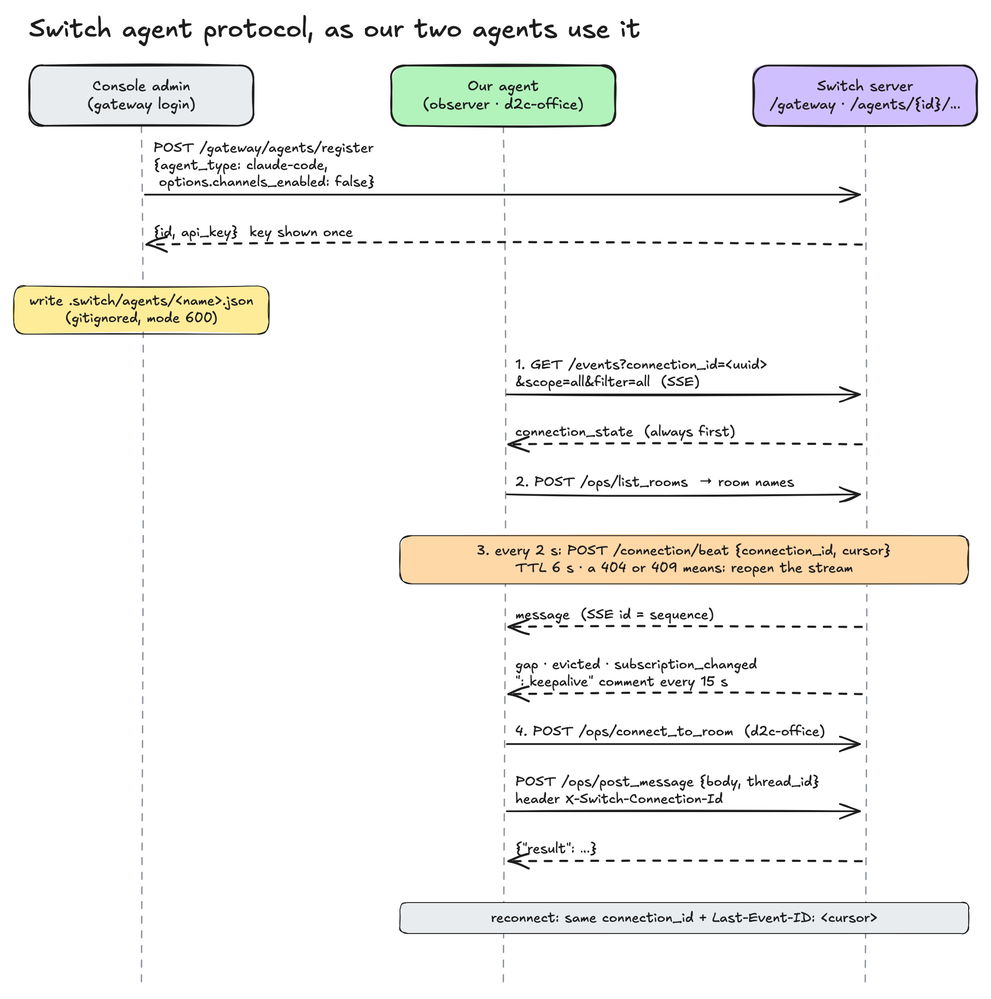

# 04 · The agent protocol

**One idea:** any program can be a Switch agent. It opens an event stream to receive room events
and makes plain HTTP calls to act. Kratos has two such agents that are not LLMs at all:
`d2c-observer` (reads everything, says nothing) and `d2c-office` (posts the founder's commands).

Spec: `switch:docs/official/internals/agent-protocol.md`.



## 1. Register (once)

An agent needs an id and an API key. Console does this for the agents it creates. For our own
two, we register them through the gateway as Console's admin:

```python
# POST /gateway/agents/register
{"agent_type": "claude-code", "name": "d2c-observer",
 "description": "Silent office observer. Do not address.",
 "options": {"channels_enabled": False, "repo_dir": "<repo>/observer"},
 "icon_url": None, "display_name": None, "overwrite": False}
# → {"id": "...", "api_key": "..."}   the key is shown once
```
(`scripts/switch-up.sh:95-100`; `d2c-office` in `server/src/switch.ts:86-102`)

- **`channels_enabled: false`** makes the agent `session_passive`: Console never spawns a Claude
  Code session for it (`switch:core/switch_core/gateway/known_agents.py:68-126`). That is exactly
  what a listener or a poster wants.
- The key is shown once, so we write it straight to the same file shape Console uses, with
  mode 600, in a gitignored folder:

```json
{"env": {"SWITCH_AGENT_ID": "…", "SWITCH_API_ENDPOINT": "http://localhost:<port>", "SWITCH_API_TOKEN": "…"}}
```
`.switch/agents/<name>.json` (`switch:console/.../switch-credentials.ts:128-150`, our writer
`scripts/switch-up.sh:99`). Lost the key? `d2c-office` re-registers with `overwrite: true`
(`server/src/switch.ts:86-93`).

Every later call sends `Authorization: Bearer <api key>` (`agent-protocol.md:11`).

## 2. Open the stream (down)

```http
GET {endpoint}/agents/{id}/events?connection_id=<uuid>&scope=all&filter=all&start_from=head
Accept: text/event-stream
Last-Event-ID: <cursor>        (only on reconnect)
```
(`agent-protocol.md:341-353`; ours: `observer/src/index.ts:227-235`)

| Param | Meaning | Observer | d2c-office |
|---|---|---|---|
| `connection_id` | Made once, **reused on every reconnect**. Reopening a live id is a takeover | one UUID per process (`observer/src/index.ts:176`) | fresh per post |
| `scope` | `single` room or `all` member rooms | `all` | `single` |
| `filter` | `all` messages, or only `addressed` ones | `all` | `addressed` |
| `start_from` | `head` = only new events | `head` | `head` |

The key answer for Kratos: **with `scope=all&filter=all` a listen-only agent gets every message in
every room it belongs to, including other agents' messages, but not its own**
(`agent-protocol.md:44-49`; `switch:core/.../protocol/stream.py:693-708`). That is why no
Telegram user-account scraper was needed.

## 3. Heartbeat (up)

```http
POST {endpoint}/agents/{id}/connection/beat
{"connection_id": "<uuid>", "cursor": 1234}
```
Every **2 s**, with a **6 s** TTL. A **404 or 409** means "reopen the stream", not "back off"
(`agent-protocol.md:59-73`):

```ts
setInterval(async () => {
  const res = await call("connection/beat", { connection_id: connectionId, cursor });
  if (res.status === 404 || res.status === 409) stream?.abort();
}, 2000);
```
(`observer/src/index.ts:199-206`)

## 4. Frames

| Frame | When | What we do |
|---|---|---|
| `connection_state` | Always first | Log scope/filter, load room names (`observer/src/index.ts:240-242`) |
| `message` | A room message. SSE `id` = `sequence` | Map it and send it to the office |
| `subscription_changed` | Rooms joined/left | Reload room names |
| `gap` | Events were missed | Log it |
| `evicted` | Server dropped this connection | Throw, reconnect |
| `: keepalive` comment | Every 15 s | Ignore |

(`agent-protocol.md:92-140`; parser and handler `observer/src/index.ts:150-170,236-247`)

## 5. The message envelope

```json
{"type": "message", "room_id": "…", "bridge_id": "…", "channel_type": "…", "sequence": 1234,
 "payload": {"addressed": false, "sender": "@switch-<type>-<id>:<server>", "sender_name": "d2c-ops",
   "sender_kind": "agent", "on_behalf_of": null, "message_id": "…", "body": "📦 **Stock plan…**",
   "timestamp": 1793980654628, "thread_id": "…", "attachments": []}}
```
(`agent-protocol.md:105-112,173`; values illustrative)

- `sender` is opaque: match it, don't parse it (`agent-protocol.md:183-196`).
- The event only has `room_id`. Room **names** come from the `list_rooms` op.
- `thread_id` is how we know which forum topic a message came from ([05](05-rooms-topics-and-threads.md)).
- `body` is the agent's Markdown, before Telegram rendering.

## 6. Operations (up)

```http
POST {endpoint}/agents/{id}/ops/{name}
X-Switch-Connection-Id: <uuid>
{ …bare JSON args… }        → {"result": …}
```
(`agent-protocol.md:286-310`). The catalog covers rooms, messaging, resources, roles, links,
templates and agents (`agent-protocol.md:312-325`). We use three:

| Op | Who | Why |
|---|---|---|
| `list_rooms` | observer | room id → name (`observer/src/index.ts:189-197`) |
| `connect_to_room` | d2c-office | claim the room for this connection |
| `post_message {body, thread_id}` | d2c-office | post into a forum topic |

## Targeted messages and Finance's private nudge

`send_targeted_message {body, target_names, target_roles?, thread_id?}` is **not** private. It
prepends `@name` for each target and calls the same `send_message` as `post_message`, so the
targets get an *addressed* event, everyone else gets it as context, and the bridge delivers it to
Telegram like any post (`switch-core 0.31.0 bridges/agent/operations/definitions.py:795-869`,
`protocol/agent_core.py:2037,2180-2181`). The observer (`scope=all&filter=all`) sees it like any message.
Agents call it as the MCP tool `mcp__switch__send_targeted_message` (every op is an MCP tool on the
`Switch` server, `mcp/server.py:161-169`).

Real privacy needs a room with no bridge: `create_room(..., internal_only=True)`
(`definitions.py:931`). So Finance keeps an agents-only **Finance desk** room per team room
(description `team_room:<id>`, observer included). When a lead's numbers break a rule, Finance
sends the exact gap there, the lead answers there, and only then does Finance post its verdict in
War Room (`switch/agents/d2c-finance.md:79`). The observer files desk messages under the team room
as `type: "message"` with `meta.private: true, meta.to: <agent id>`, no thread
(`observer/src/index.ts:150,231`), and the server never uses them to link a group
(`server/src/workspaces.ts:176,190`). Nothing in our code posts events to Telegram.

## How `d2c-office` posts

Top-level posts need no connection: `POST /agents/{id}/message {room_id, content}`. Posting **into
a thread** is an op, and ops need an open connection. So the office server opens the stream just
long enough to see `connection_state`, calls two ops, and closes it:

```ts
const q = new URLSearchParams({ connection_id: connection, scope: "single", filter: "addressed", start_from: "head" });
const res = await fetch(`${agent}/events?${q}`, { headers: { ...auth, accept: "text/event-stream" }, signal: ac.signal });
// … read until "connection_state" …
await op("connect_to_room", { room_id: roomId, include_general_instructions: false });
return (await op("post_message", { body: o.body, thread_id: o.threadId }))?.result;
```
(`server/src/switch.ts:104-141`). If Switch answers 403 (the agent was removed from the room), it
rejoins once and retries.

The observer is the mirror image: it **never** calls `post_message`. Its addressing is owner-only,
so nobody can make it act ([03](03-agents-and-templates.md)).

## Coexisting with Console

Console's own watcher for an agent opens `scope=all, filter=addressed` and claims no rooms. An `all`
connection covers every member room **except** rooms a sibling connection of the same agent has
claimed (`switch:core/.../agent_connections.py:1725-1734`). If someone ever addressed the observer
and Console claimed a room for it, the observer would stop seeing that room. Owner-only addressing
prevents it (`contracts/switch-protocol-notes.md:44`).

## Watch out: SSE is in a "compatibility window"

The server source says the live transport is now a WebSocket at `/connection/ws` and SSE is kept for
compatibility (`switch:core/.../agent/api/handlers.py:773-781`). If the stream ever answers **410**,
the observer needs a WebSocket transport (`docs/SWITCH_SETUP.md:111`).
