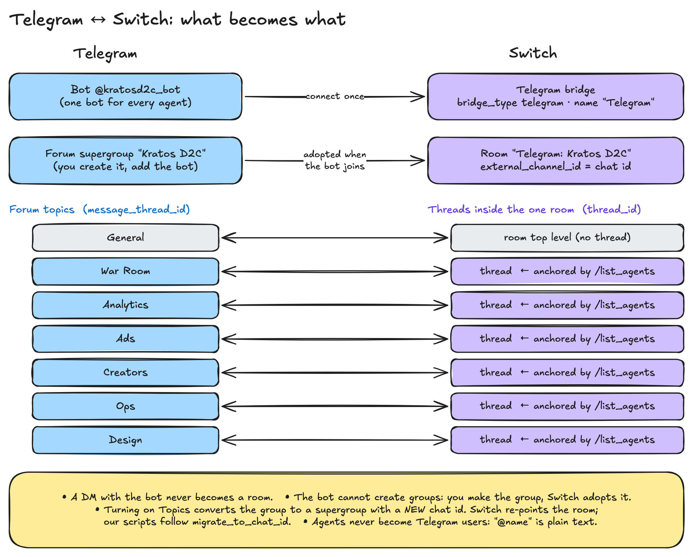

# 05 · Rooms, forum topics and threads

**One idea:** Kratos is **one** Switch room (the Telegram group) with **six threads** (the forum
topics). Getting a topic to behave as a Switch thread takes one small trick: `/list_agents`.



## Why one group with topics (and not seven groups)

An alternative layout is seven Telegram groups, one per department. Kratos uses **one supergroup with Topics on** instead:

- one place for the founder to look, with a tab per department;
- one Switch room, so every agent shares one context and can hand work across topics;
- one bot admin setup instead of seven.

`contracts/roster.json` records the decision: "One Telegram supergroup with Topics on; each room
below is a topic. Switch sees one room; topics are threads (message_thread_id)."

## What maps to what

| Telegram | Switch | Our id |
|---|---|---|
| Bot `@kratosd2c_bot` | Telegram bridge (`display_name: "Telegram"`) | – |
| Supergroup "Kratos D2C" | Room **"Telegram: Kratos D2C"**, `external_channel_id` = chat id | workspace |
| General topic | Room top level, no thread | – |
| War Room … Design topics | Threads (`thread_id`) | `war_room` … `design` |
| `message_thread_id` | `payload.thread_id` (once anchored) | `meta.thread_id` |

## Making the topics

A bot can create forum topics if the group is a forum and the bot is an admin with
**Manage topics**. Our script checks both and creates the six topics (idempotent: a stored topic
that still exists is kept):

```bash
tg getChat --data-urlencode "chat_id=$CHAT_ID"                  # is_forum?
tg getChatMember ... -d "user_id=$BOT_ID"                        # admin + can_manage_topics?
tg createForumTopic --data-urlencode "chat_id=$CHAT_ID" --data-urlencode "name=War Room" -d "icon_color=7322096"
```
(`scripts/switch-up.sh:122-152`). In v3 the office server does the same per linked workspace
(`server/src/workspaces.ts:232-264`, see [08](08-accounts-and-workspaces.md)).

## The `/list_agents` trick: anchoring a topic as a thread

A Switch thread is rooted at a Switch message. A brand-new forum topic has no such message yet,
so Switch has no thread for it. Without one, an agent or the office can't *post* into that
topic, only reply to a message that is already there.

What we found: **when someone sends a command in a topic, Switch maps that command post to the
bare topic id**. After that the topic has a Switch thread. So the go-live checklist says:

> In each of the 6 topics, send `/list_agents` once. This makes Switch treat the topic as one
> conversation. (`docs/GO_LIVE.md:12-13`)

`switch-up.sh` then reads the mapping (read-only) from Switch's `bridge_message_map` table and
writes it to `observer/topics.json`:

```python
sql = ("set default_transaction_read_only=on; ... "
       f"select transport_event_id from bridge_message_map where bridge_id='{bridge}' and external_post_id='{int(tid)}';")
topics[key] = {"name": name, "message_thread_id": int(tid), "switch_thread_id": ev[-1] if ev else None}
```
(`scripts/switch-up.sh:153-179`). Topics still missing an anchor are printed as a to-do.

> This was found by reading Switch's tables, not from the docs. It works on the Switch version we
> ran; treat it as an implementation detail, not an API.

### What uses `switch_thread_id`

- **The observer** maps an incoming `thread_id` to a department topic, so a message lands in the
  right zone of the office (`observer/src/index.ts:124-131`).
- **The agents** are told to post their own work "in your department topic … by passing its
  switch_thread_id as thread_id" (`switch/agents/d2c-captain.md:40-43`).
- **`d2c-office`** posts a founder command into the topic's thread with `post_message`. If the
  topic has no thread yet, it posts to General with a hashtag instead, and the agents still act:

```ts
const tag = threaded ? "" : `#${(room.topic ?? room.label).replace(/\W+/g, "")} `;
return `${tag}${!named && lead ? `@${lead.id} ` : ""}${text}`;
```
(`server/src/office.ts:55-63`). It also addresses the topic's lead agent when the founder names
nobody, because Switch agents only act on messages that address them.

## The `"Telegram: "` room-name prefix gotcha

We named the group "Kratos D2C" and matched rooms by that name. Nothing matched. Switch names a
bridged room after the bridge's display name **plus** the channel name:

```python
room.id, f"{bridge.display_name}: {channel_name}", channel_name
```
(`switch:core/switch_core/gateway/rooms.py:1373`). Our bridge is called "Telegram", so the room is
**"Telegram: Kratos D2C"**. The fix, in every place that matches by name:

```ts
// Switch prefixes bridge rooms ("Telegram: Kratos D2C"), so match the forum name as a suffix too.
if (forum.has(n) || forum.has(norm(id)) || [...forum].some((f) => n.endsWith(": " + f))) {
```
(`observer/src/index.ts:126-127`, commit `5ec8d2f`; also `server/src/switch.ts:77`; v3 strips it:
`meta.room_name.replace(/^Telegram:\s*/i, "")`, `server/src/workspaces.ts:146`).
Better still, match by Telegram chat id when you have it (`server/src/switch.ts:73-80`).

## Adding agents to the room

- From Telegram: `/invite_agent @agent-name` (or `!invite-agent`) inside the group; `!list-agents`
  shows who is in (`switch:docs/official/getting-started/create-a-room.md:87-93`).
- From code, as the Console admin: `POST /gateway/rooms/{room_id}/agents {"agent_ids": [...]}`
  (`scripts/switch-up.sh:115-116`, `server/src/switch.ts:81`). This is how the team, the observer,
  `d2c-office` and every hire get in.

## Chat id changes when the group becomes a forum

Turning on Topics converts a basic group to a **supergroup with a new chat id**. Switch re-points
the room on its own (`switch:docs/official/deploy/messaging-apps/telegram.md:173,212`). Our own
Bot API calls follow Telegram's `migrate_to_chat_id` hint:

```bash
NEW_ID=$(echo "$CHAT" | json 'print((d.get("parameters") or {}).get("migrate_to_chat_id") or ...)')
if [ -n "$NEW_ID" ]; then CHAT_ID=$NEW_ID; CHAT=$(tg getChat --data-urlencode "chat_id=$CHAT_ID"); fi
```
(`scripts/switch-up.sh:126-128`; same in `server/src/workspaces.ts:233-238`)
