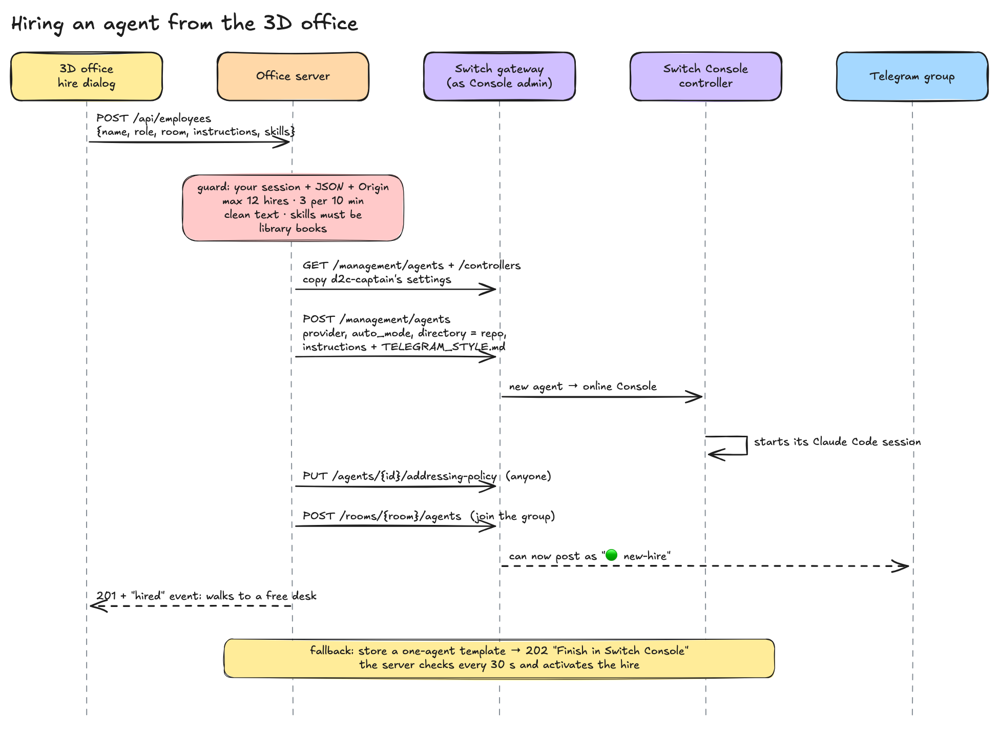

# 06 · Hiring agents from the office

**One idea:** the founder clicks **Hire** in the 3D office, and a new Claude Code agent appears in
the Telegram group a few seconds later. No Console click. That works because Switch exposes the
same **management API** that Switch Console itself uses.



## The request

```http
POST /api/employees
{"name": "Riya", "role": "Retention lead", "room": "ops", "emoji": "💌",
 "instructions": "Win back customers who bought once…", "skills": ["gstack:retro"]}
```
→ `201 Employee`, or `202 {employee, action: {kind: "open_url", url: "switchdash://…", label: "Finish in Switch Console"}}`
(`contracts/api.md:74`)

## What the server does, step by step

1. **Guard and clean** the request (see "Caps and security fixes" below).
2. **Copy the team's settings.** Read the managed agents and controllers, take `d2c-captain`'s
   definition, pick the online Console controller:

```ts
const managed = await gw("GET", "/management/agents");
const lead = managed.find((a) => a.name === TEAM_LEAD);
const controllers = await gw("GET", "/management/controllers");
const ctl = online.find((c) => c.id === lead?.controller_id) ?? online.find((c) => c.kind === "console");
```
3. **Create the managed agent** on that controller, running:

```ts
await gw("POST", "/management/agents", {
  name: h.id, description: h.description, display_name: h.displayName, icon_url: null,
  controller_id: ctl.id, desired_state: "running",
  definition: { provider, model, advanced_config, auto_mode, auto_approve, isolation,
                directory: h.directory /* always the repo */, instructions: h.instructions },
});
```
(`server/src/switch.ts:148-168`)

4. **Console starts its Claude Code session** on this Mac, in the repo, like the rest of the team.
5. **Open addressing and join the room:** `PUT /agents/{id}/addressing-policy {"policy": null}`
   (anyone), then `POST /rooms/{room}/agents` (`server/src/switch.ts:192-196`).
6. **Tell the office.** The server stores the employee, gives it a free desk in its department
   zone and emits a `hired` event; the office walks the new person in (`server/src/office.ts:207-214`).

The hire's instructions are built from the form plus the team's rules:

```ts
`You are ${e.name}, ${e.role} at Kesar & Co., a D2C skincare brand. You were just hired from the office screen.`,
e.instructions,
`Skills from the office library to use when relevant: ${e.skills.join(", ")}.`,
telegramStyle(root),            // switch/TELEGRAM_STYLE.md, re-read on every hire
`… yours is ${topic}. … Reply in the topic that addressed you … Report to @${lead}.`, // reports_to, else the department lead
catchUpBlock(topic, lead),     // "FIRST THING YOU DO", see below
```
(`server/src/office.ts:92-103`)

## Joining already briefed (read_context)

A hire should not ask "what's going on?". Its first turn is a catch-up:

1. **The instructions say so.** Every hire's instructions end with a "FIRST THING YOU DO" block
   (`catchUpBlock`, `server/src/office.ts:90-100`): call `mcp__switch__read_context` with
   `{"limit": 100}`, read the War Room (top-level threads) and its department topic (the thread of
   the message that addressed it), then post **one** catch-up with `mcp__switch__post_message` in
   that thread: a bold "🧾 **Caught up on …**" title, 2-4 bullets, an italic Next line to its lead.
2. **The server gives it a first turn.** Right after create + join, the server waits until Switch
   shows the agent `live` in the room (`GET /gateway/agents/{id}`, `rooms[].status`; up to
   `KICKOFF_WAIT_MS`, default 2 min, `server/src/switch.ts:261-271`), then `d2c-office` posts
   `@<new-agent> you just joined — catch up and say hello` in the department topic, or top level
   (War Room) when Switch has no thread for it yet (`server/src/office.ts:124-133`). Waiting matters:
   a new agent connection starts at its newest event, so a message sent before Console's
   controller is watching never arrives (`switch:bridges/agent/api/handlers.py:766-829`).
   Only fresh managed hires get it; template fallbacks, `syncPending` and restarts do not.
3. **The office sees it.** The hire's next message through the observer is tagged
   `meta.kind: "catch_up"` (`tagCatchUp`, `server/src/office.ts:119-122`).

How `read_context` works (switch-core 0.31.0):

- It is an agent **operation**; every operation is also an MCP tool of the Switch MCP server
  (`switch:bridges/agent/mcp/server.py:161-169`), which Claude Code shows as
  `mcp__switch__<tool>` (Console's agent-controller skill text, `agent-controller.mjs:79213`).
  Over HTTP it is `POST /agents/{id}/ops/read_context`, or `GET /agents/{id}/rooms/{room}/history`
  (`switch:bridges/agent/api/handlers.py:1653`).
- Args: `limit` (default 50, capped at 500, `switch:bridges/agent/protocol/agent_core.py:183-186`),
  `since` / `before` (ISO-8601), `room_id` (omit = the connected room; any room you are a member of
  otherwise). It has no thread filter: it reads the whole room
  (`switch:bridges/agent/operations/definitions.py:639-731`).
- Returns `{threads: [{root, replies}], truncated, oldest_timestamp}`, freshest thread last; each
  entry is `{id, kind: "message"|"room_join", sender, sender_name, body, timestamp, attachments}`.
  Reading the connected room also clears its unread count.

(`switch:` paths here are `switch_core/` in the installed 0.31.0 package.)

## Auto mode

The definition's `auto_mode` lets the Claude Code session work without stopping to ask for each
tool permission. Switch defaults it to on for new definitions (`switch:core/switch_core/management/schemas.py:91`;
"Bypass" skips every check and wins over it, `:92`). We don't choose it per hire: hires **copy**
`auto_mode` and `auto_approve` from `d2c-captain`, so a hire is never more permissive than the team
(`docs/GO_LIVE.md:63-64`).

## The fallback: a one-agent template

If managed agents are unavailable (for example, Console's controller is offline), the server stores
a one-agent template and returns a Console deep link instead:

```ts
// JSON is valid YAML, so no YAML writer is needed.
const content = JSON.stringify({ version: 1, params: {...}, agents: [{ name: h.id, addressing: "anyone",
  provider: "claude", location: "local", directory: "{directory}", join: ["{team_room}"], instructions: h.instructions }] });
```
(`server/src/switch.ts:180-190`). The employee shows as `pending_console`; every 30 s the server
checks whether Console has created the agent, then activates it (`server/src/office.ts:109-121`).

## Firing

`DELETE /api/employees/:id` stops managing the agent (Console stops its session), deletes the
Switch agent, and frees the desk (`server/src/switch.ts:170-178`, `server/src/office.ts:139-148`).

## Joins

Every agent that must hear the group is joined through the same gateway call,
`POST /gateway/rooms/{room}/agents {"agent_ids": [...]}`: the six team agents and the observer
(`scripts/switch-up.sh:115-116`), `d2c-office` on first use (`server/src/switch.ts:96`), each hire
(`activate`), and in v3 every agent of a newly linked workspace (`server/src/workspaces.ts:266`).

## Caps and the security fixes

Hiring spawns a real coding agent with repo access, so it is the most dangerous button in the app.
An adversarial review of the first version led to these fixes (commits `4371981`, `d47a9ce`,
`91484d0`; v3):

| Risk | Fix | Where |
|---|---|---|
| A web page on another site POSTs `/api/employees` (CSRF) | Writes need `content-type: application/json`, the office's own `Origin`, and a local `Host` | `server/src/index.ts:107-126` |
| DNS rebinding (an attacker domain that resolves to 127.0.0.1) | `Host` must be `localhost`, `127.0.0.1`, `[::1]` or listed in `OFFICE_ORIGINS` | same |
| A proxy makes a remote request look local | Trusted only if every `X-Forwarded-For` hop is loopback; `TRUST_LOOPBACK=0` behind a reverse proxy | `server/src/index.ts:36-37,118-123` |
| Someone else's office hires into your group | v3: writes need the session that owns the workspace (or `ADMIN_TOKEN`); 409 until the workspace is ready | `contracts/api.md` v3 |
| Hire spam fills the Mac with sessions | Max **12** employees (`HIRE_MAX`), max **3 hires per 10 min**, 10 commands a minute | `server/src/office.ts:23-25,180-185` |
| Prompt smuggling through the form | Control chars, zero-width and bidi overrides stripped; length limits on every field | `server/src/office.ts:33-42` |
| The request picks the working directory | `directory` is always the repo, set by the operator only | `server/src/office.ts:106` |
| Arbitrary "skills" text | Skills must be ids of books in the library, max 20 | `server/src/office.ts:174-179` |
| Name clash with an existing Switch agent | Ids are checked against roster, employees, in-flight hires **and** Switch's own agent list | `server/src/office.ts:70-76` |
| Switch errors leaking internals | Callers get "Switch refused the request"; the detail goes to the server log only | `server/src/switch.ts:16-22,45` |

> Suggested blog line: "The Hire button is a `POST` that starts a coding agent on my laptop. It
> got the most review of anything in the repo."
