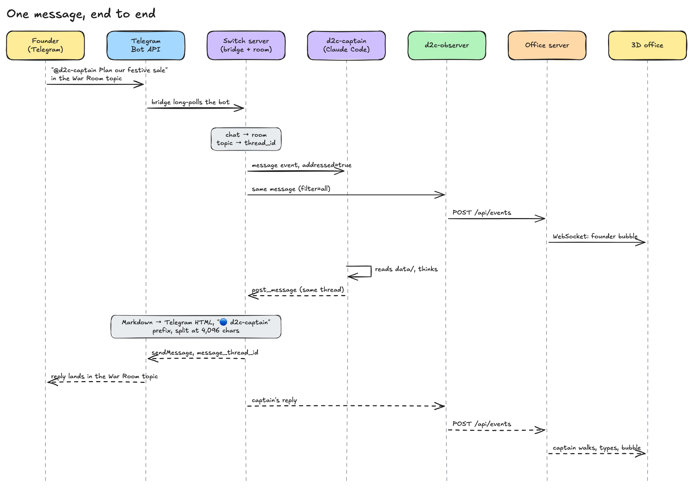

# 07 · The observer and the live office

**One idea:** the 3D office is a *view* of Switch. A silent Switch agent copies every room
message to our server, the server pushes it to browsers over a WebSocket, and the office animates
it. Nothing in the office talks to Telegram directly.



## The pipeline

```text
Telegram topic ─► Switch room ─► d2c-observer ─► POST /api/events ─► office server ─► WS /ws ─► 3D office
  (founder)       (bridge)       (SSE, scope=all)  (OBSERVER_TOKEN)    (SQLite + schema)  (push)    (React + three.js)
```

## 1. Switch → observer

`d2c-observer` is a passive Switch agent in the room. It opens the stream with
`scope=all&filter=all`, so it gets every message from people and agents ([04](04-agent-protocol.md)).
It has no runtime dependencies and runs the `.ts` file directly on Node ≥ 22.18
(`observer/README.md`).

## 2. Observer: message → `OfficeEvent`

For each `message` frame (`observer/src/index.ts:208-225`):

| Step | How |
|---|---|
| **Who spoke** | `on_behalf_of ?? sender_name`, matched against `contracts/roster.json` ids and names, then `config.speakers` (`d2c-office` → `founder`), then hired employees. Unknown → `founder`, logged |
| **Ignore** | `ignoreSpeakers`: Switch's own voice and the observer itself |
| **Which topic** | `payload.thread_id` → `topics.json` → department room; else the speaker's home topic; else `war_room` ([05](05-rooms-topics-and-threads.md)) |
| **What kind** | Keyword guess: `approval_needed`, `pushback`, `approved`, else `message` |
| **Who was asked** | Every `@d2c-*` mention → `meta.targets` |

The type guess is deliberately simple, and says so:

```ts
// ponytail: keyword heuristic; order matters (captain's final "Finance approved… please approve" is approval_needed).
export function inferType(text: string): string {
  if (/please approve|approve\?|your approval|for approval|awaiting approval|sign[- ]?off/i.test(text)) return "approval_needed";
  if (/push(ing)? back|over budget|over the budget|❌|\bcut\b/i.test(text)) return "pushback";
  if (/\bapproved\b|✅/i.test(text)) return "approved";
  return "message";
}
```
(`observer/src/index.ts:141-147`)

A new hire's first message would map to `founder`, because the observer has never heard the name.
So on an unknown name it asks the office server for the current people first
(`observer/src/index.ts:214-215`, commit `b4533a4`).

Example event:

```json
{"t": 1793980654628, "room": "ops", "speaker": "d2c-ops", "type": "message",
 "text": "📦 **Stock plan for the sale** …", "meta": {"targets": ["d2c-captain"], "thread_id": 5}}
```

## 3. Observer → server, reliably

Delivery is a FIFO outbox, one POST at a time so order is kept. 429, 5xx and network errors retry
the head with backoff from 1 s to 30 s; 400 and 401 are final; a full outbox (500) drops the oldest
(`observer/src/index.ts:48-79`). The server accepts `POST /api/events` only with
`Authorization: Bearer $OBSERVER_TOKEN` (`contracts/api.md:10`).

## 4. Server: validate, store, broadcast

The server checks each event against `contracts/events.schema.json`, assigns its own id, stores it
in SQLite (newest 10,000 kept) and sends it to every WebSocket client (`server/src/index.ts:58-61,254`;
`contracts/api.md:47`). In v3 the server also decides which **workspace** the room belongs to, and
each socket only gets its own workspace's events ([08](08-accounts-and-workspaces.md)).

## 5. Browser: history, then live

The office opens `WS /ws` **first** and buffers, then loads `GET /api/history?limit=200`, then
plays history followed by the buffer, deduped by id. So nothing is lost between the two
(`web/src/shared/live.ts:6-9`, commit `21d4f68`). It reconnects with backoff; if the live socket
stays down for 5 s it falls back to a local replay instead of freezing (commit `5f238ab`).

## 6. Office: events → animation

A reducer folds events into per-person state (`web/src/office/officeState.ts`, rules in
`contracts/api.md:48-51`):

| Event | Effect |
|---|---|
| `assign` | Speaker and targets start working: they walk to their desks |
| `message` | Speech bubble, Telegram-style chat line, topic unread badge |
| `pushback` | Speaker works, targets wait (red beacon) |
| `approval_needed` | Waits for the founder |
| `approved` / `done` / `artifact` | Done; an artifact's banner appears on the gallery wall |
| `hired` | A new person walks in to a free desk |
| `celebrate` | Everyone done, confetti |

Agent text is rendered as **safe Telegram-style Markdown**, built as DOM nodes, never `innerHTML`,
"so nothing an agent or a SKILL.md says can run" (`web/src/office/md.tsx:1`).

## Without Switch

The public landing page and `/demo` replay a recorded feed (`demo/feeds/sale-demo.json`) in the
browser. No server, no Switch, no real messages (`contracts/api.md` v3 rule). The live office at
`/app` needs a signed-in user and a linked group.

## The reverse path: commands

From the office's command bar, `POST /api/command {room, text}` is posted into the topic by
`d2c-office` ([04](04-agent-protocol.md)). The founder never sees a special path: the command shows up in
Telegram, the observer picks it up like any message, and it appears in the office as the founder's line.
