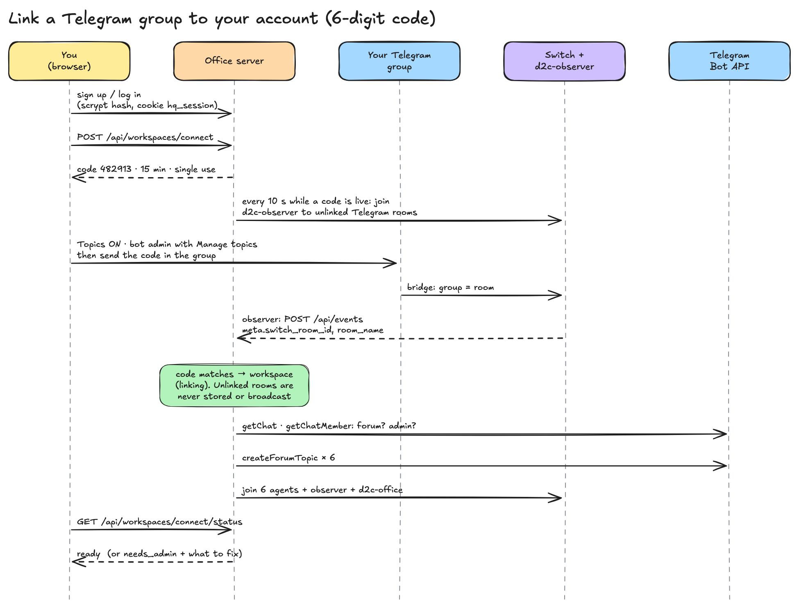

# 08 · Accounts and workspaces (link a group with a 6-digit code)

**One idea:** a workspace is **one Telegram group = one Switch room = one user's private office**.
You prove a group is yours by sending a 6-digit code in it. Switch carries the code to us like
any other message.

> Status: built on branch `task/A1` (contract v3), being merged now. Sources are cited as
> `task/A1:<path>`; `git show task/A1:contracts/api.md` has the full contract.



## Why accounts at all

Before v3 the office showed every message the observer saw. Once the bot can be in more than one
group, that would show one founder's sales numbers to another. The rule now
(`contracts/api.md`, "v3"):

> the public site (`/`) shows ONLY the scripted demo … Every real Telegram message, the live
> office, people, hires and commands require a signed-in user and are scoped to that user's workspace.

## Accounts

- Email + password, hashed with **scrypt** (`N = 2^15`, r = 8), min 10 characters
  (`task/A1:server/src/auth.ts:1-17`). Unknown emails still pay one scrypt, so login time doesn't
  reveal which emails exist (`auth.ts:25`).
- Session = random 32-byte id in cookie `hq_session` (HttpOnly, SameSite=Lax, Secure over https,
  30 days), stored **hashed** in SQLite.
- Login: 5 a minute per IP + email. Signup: 5 a minute per IP. Codes: 5 an hour per user.

## Linking a group, step by step

| # | Who | What |
|---|---|---|
| 1 | You, in Telegram | Topics **on**; add `@kratosd2c_bot` as admin with **Manage topics** |
| 2 | You, in the browser | Sign up, open `/connect`, get a code (`POST /api/workspaces/connect`) |
| 3 | Server | Every 10 s while any code is live, joins `d2c-observer` to every Telegram room in Switch that has no workspace yet |
| 4 | You, in Telegram | Send the code as a message in the group |
| 5 | Switch → observer → server | The message arrives with `meta.switch_room_id`, `room_name`, `chat_id` |
| 6 | Server | Code matches: create the workspace (status `linking`), mark the code used |
| 7 | Server → Telegram Bot API | `getChat` + `getChatMember`: is it a forum, is the bot an admin? No → `needs_admin` |
| 8 | Server → Telegram Bot API | `createForumTopic` × 6 (idempotent) |
| 9 | Server → Switch gateway | Join the 6 team agents, the observer and `d2c-office` to the room |
| 10 | You | `/connect` shows **ready**; `/app` shows only your group |

(`docs/GO_LIVE.md` on task/A1; code in `task/A1:server/src/workspaces.ts`)

### Step 3 is the clever part

A group the bot was **just** added to is a new Switch room with no agents in it. The observer
isn't a member, so it would never see the code. So while a code is live, the server adds the
observer to every unclaimed Telegram room:

```ts
const rooms = await gw("GET", "/rooms");
const fresh = rooms.filter((r) => r.bridge_type === "telegram" && !observerIn.has(r.id) && !wsByRoom(r.id));
for (const r of fresh) await joinRoom(r.id, obs.id);
```
(`task/A1:server/src/workspaces.ts:96-109`). If you sent the code before the observer got in,
sending it again works.

### The code

```ts
do code = String(randomInt(0, 1_000_000)).padStart(6, "0");
while (liveCode(code)); // unique among live codes
sql().prepare("INSERT INTO link_codes (code_hash, user_id, created_at, expires_at) VALUES (?, ?, ?, ?)")
  .run(sha(code), user.id, now, expiresAt);
```
(`task/A1:server/src/workspaces.ts:71-82`)

- 6 digits, **15 minutes**, **single use**; a new code voids your older ones.
- Stored as a **hash**, never in clear.
- The server scans each message for 6 digits standing alone; at most **10 wrong guesses per room
  per 10 minutes** (`workspaces.ts:111-126`). "1e6 codes × 15 min makes guessing hopeless."
- A room already linked to someone else can't be claimed; the status explains why.

## Per-workspace privacy

- **Unlinked rooms are never stored or broadcast.** A message from a room with no workspace is
  only recorded as a *link attempt*: room id, name, chat id, time, never the text
  (`task/A1:contracts/api.md`, "v3 details"; `workspaces.ts:145-151`).
- Every stored event gets a server-assigned `ws`. Any `ws` the observer sends is ignored.
- `/api/history`, `/ws`, `/api/rooms`, `/api/people`, `/api/command`, `/api/employees` and the
  library need a session and act on `?ws=<id>`. Someone else's `ws` → 403. Each WebSocket only
  gets its own workspace's events.
- Office writes need the session that **owns** the workspace (or `ADMIN_TOKEN`), and answer 409
  until it is `ready`.

## How Switch makes this possible

- **The bridge adopts any group the bot joins as a room** ([02](02-telegram-bridge.md)), so a
  new customer needs no Switch setup at all.
- **The gateway API** lists rooms with their `bridge_type` and Telegram chat id, and joins agents
  to rooms, so the server can wire up a workspace without a human in Console.
- **One team of agents serves every workspace.** The six agents are joined to each linked room;
  Switch keeps each room's context separate.

## Re-linking and the old group

- If Switch re-creates the room for the same Telegram group, the server matches it by **chat id**
  and follows the new room id (`workspaces.ts:153-162`).
- The pre-v3 "Kratos D2C" group is recognised by the chat id in `observer/topics.json`, **never by
  name** ("anyone can name a group 'Kratos D2C'"), and keeps its topics and history once linked
  (`workspaces.ts:203-219`).
