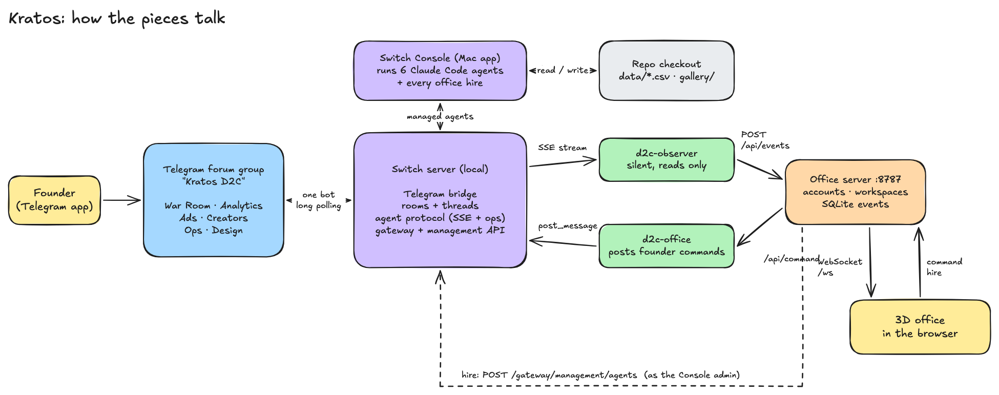

# How Kratos uses Switch

Kratos (formerly "D2C Agent HQ") gives every department of a D2C brand an AI teammate. The
teammates work in **one Telegram group with forum topics**, and a live 3D office shows what they
are doing. **Switch** is the part that makes the agents real: it runs them, puts them in Telegram,
and lets our code watch and talk to them.

These pages document every Switch feature Kratos uses, with real snippets and sources, so they can
be lifted straight into a blog post.

## What Switch is (one paragraph)

[Switch](https://github.com/sandbox-quantum/switch) is open-source software that puts AI coding
agents (Claude Code, Codex, OpenCode and others) into the chat apps a team already uses: Slack,
Teams, Discord, Telegram and Mattermost. Each chat becomes a **room** where people and agents
work from the same conversation. You run a **Switch server** (locally through the **Switch
Console** desktop app, or on a host), connect a chat app through a **bridge**, and add agents.
Agents talk to the server over an open **agent protocol** (an event stream down, HTTP calls up),
so you can also write your own agents. Switch's own tagline: "Open-source AI teammates, working
alongside your team in Slack, Teams, Discord, Telegram and Mattermost" (`switch:README.md`).

## The architecture

- The founder types in a **Telegram topic**. One bot carries every agent.
- **Switch** turns the group into one room and each topic into a thread. **Switch Console** runs
  the 6 department agents as Claude Code sessions in this repo.
- `d2c-observer`, a silent agent of ours, reads every message over the agent protocol and posts
  it to the **office server**, which pushes it to the **3D office** over a WebSocket.
- From the office, the founder can **send commands** (posted by our `d2c-office` agent) and
  **hire new agents** (created through Switch's management API).

## Pages

| # | Page | One line |
|---|---|---|
| 01 | [Console and the local server](01-console-and-local-server.md) | One desktop app, no Docker, Claude Code as the provider |
| 02 | [The Telegram bridge](02-telegram-bridge.md) | One bot for all agents, privacy mode, Markdown to Telegram HTML |
| 03 | [Agents and templates](03-agents-and-templates.md) | The team as one YAML file, addressing, shared style, live sync |
| 04 | [The agent protocol](04-agent-protocol.md) | Register, stream, heartbeat, ops: how our two custom agents work |
| 05 | [Rooms, topics and threads](05-rooms-topics-and-threads.md) | One room, six topics, `/list_agents`, the `Telegram: ` prefix |
| 06 | [Hiring agents from the office](06-hiring-agents-from-the-office.md) | Management API, auto mode, caps and the security fixes |
| 07 | [Observer and live office](07-observer-and-live-office.md) | Telegram → Switch → observer → server → WebSocket → 3D |
| 08 | [Accounts and workspaces](08-accounts-and-workspaces.md) | Link a group with a 6-digit code, private per-workspace office |
| 09 | [Skills library and librarian](09-skills-library-and-librarian.md) | 316 installed skills shelved by Claude Code in 45 s |
| 10 | [Gotchas and lessons](10-gotchas-and-lessons.md) | Every real problem we hit, and the fix |
| — | [Blog outline](blog-outline.md) | A ready skeleton for the "Flip the Switch" post |

## Diagrams

All diagrams are Excalidraw files: open the `.excalidraw` at excalidraw.com (File → Open) to edit.

| Diagram | Files |
|---|---|
| System architecture | [png](../diagrams/architecture.png) · [svg](../diagrams/architecture.svg) · [excalidraw](../diagrams/architecture.excalidraw) |
| One message, end to end | [png](../diagrams/message-lifecycle.png) · [svg](../diagrams/message-lifecycle.svg) · [excalidraw](../diagrams/message-lifecycle.excalidraw) |
| Telegram ↔ Switch mapping | [png](../diagrams/telegram-switch-mapping.png) · [svg](../diagrams/telegram-switch-mapping.svg) · [excalidraw](../diagrams/telegram-switch-mapping.excalidraw) |
| Agent protocol | [png](../diagrams/agent-protocol.png) · [svg](../diagrams/agent-protocol.svg) · [excalidraw](../diagrams/agent-protocol.excalidraw) |
| Hiring flow | [png](../diagrams/hiring-flow.png) · [svg](../diagrams/hiring-flow.svg) · [excalidraw](../diagrams/hiring-flow.excalidraw) |
| Workspace linking | [png](../diagrams/workspace-linking.png) · [svg](../diagrams/workspace-linking.svg) · [excalidraw](../diagrams/workspace-linking.excalidraw) |
| The build swarm | [png](../diagrams/build-swarm.png) · [svg](../diagrams/build-swarm.svg) · [excalidraw](../diagrams/build-swarm.excalidraw) |

## Switch features at a glance

| Switch feature | Used? | Where |
|---|---|---|
| Switch Console + local server (no Docker) | yes | [01](01-console-and-local-server.md) |
| Agent providers (Claude Code) | yes | [01](01-console-and-local-server.md) |
| Telegram bridge, one bot, forum topics | yes | [02](02-telegram-bridge.md), [05](05-rooms-topics-and-threads.md) |
| Markdown → Telegram HTML, 4,096-char splitting | yes (we write for it) | [02](02-telegram-bridge.md) |
| Agent templates (YAML), params, `join` | yes | [03](03-agents-and-templates.md) |
| Addressing policies (`anyone`, owner only) | yes | [03](03-agents-and-templates.md) |
| Managed agents (definitions, revisions, controller) | yes | [03](03-agents-and-templates.md), [06](06-hiring-agents-from-the-office.md) |
| Agent protocol: SSE stream, heartbeat, ops | yes | [04](04-agent-protocol.md) |
| Passive agents (`channels_enabled: false`) | yes | [04](04-agent-protocol.md) |
| Rooms, threads, `/list_agents`, `/invite_agent` | yes | [05](05-rooms-topics-and-threads.md) |
| Gateway admin API (rooms, agents, templates, bridges) | yes | [06](06-hiring-agents-from-the-office.md), [08](08-accounts-and-workspaces.md) |
| Shared room context, documents, references | not yet | see below |

### Switch features we could use next

- **Room documents and references** (`create_room_document`, `attach_reference_to_room`): pin the
  sale brief or the product CSVs to the room instead of reading files from a shared directory.
  (`switch:docs/official/internals/agent-protocol.md` "The operation catalog")
- **Roles** (`define_role`, `assume_role`): "whoever is Ops this week" instead of a fixed agent name.
- **Linked rooms and room groups**: one room per brand, linked to a shared leadership room.
- **More bridges**: the same team in Slack or Discord with no code change, since the observer only
  sees Switch rooms. WhatsApp is not a Switch bridge today.
- **`send_targeted_message` and `read_context`**: private nudges and catching up on history.
- **Remote host** (`switch:docs/official/deploy/host-remotely.md`): a server that survives a reboot.
- **Tasks** (`delegate_task` …) exist in the protocol but are marked "not ready for use".

## Sources and how to read citations

- `path:line` = a file in this repo.
- `switch:path:line` = the Switch source, [`sandbox-quantum/switch`](https://github.com/sandbox-quantum/switch)
  at commit `93c132c`. `switch:docs/official/*` is the synced copy of docs.switchagents.ai.
- `task/A1:path` = the accounts branch, being merged now.
- The research notes behind all of this: [`contracts/switch-protocol-notes.md`](../../contracts/switch-protocol-notes.md).
